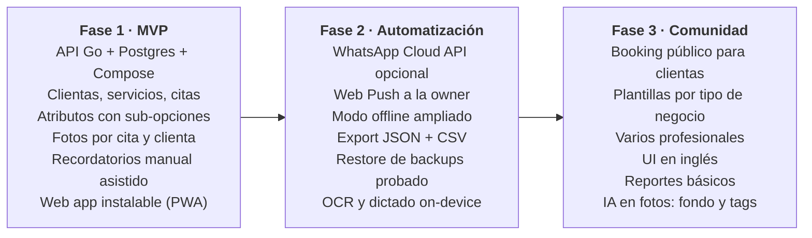

# PRD — Sistema de citas para emprendimientos

Oct 23, 2026 · jnaranj09

## Resumen y problema

Un sistema open source y self-hosted de clientes y citas para emprendimientos de servicios, empezando por un negocio de uñas. Lo componen una API en Go con PostgreSQL, un web client instalable como PWA en el iPhone, y se levanta con un solo `docker compose up`.

Hoy una emprendedora de uñas lleva clientas, citas y recordatorios entre WhatsApp, una libreta y su memoria. Las herramientas existentes (AgendaPro, Fresha, Booksy) resuelven la agenda, pero tienen tres huecos:

- Los custom fields son limitados y casi nunca se pueden usar dentro de los mensajes, así que no se puede escribir "Aquí te esperamos con tu {bebida favorita}".
- Los datos viven en la plataforma de otro, con costo mensual y SMS cobrados aparte.
- No hay una opción gratuita que cualquiera pueda hospedar y adaptar a su propio tipo de negocio.

## Objetivos y no-objetivos

**Objetivos**

1. Registrar una cita completa (clienta, servicio, atributos, fotos) en menos de 30 segundos desde el iPhone.
2. Que ninguna clienta se pierda un recordatorio ni un relleno: recordatorios por cita y por servicio, personalizados con atributos de la clienta.
3. Que la app se sienta instantánea: p95 de la API bajo 50 ms y pantallas principales cargadas bajo 1 segundo.
4. Que cualquier persona técnica pueda levantarla en su servidor en menos de 10 minutos con Docker Compose.
5. Que el modelo de atributos sea lo bastante genérico para servir a otros negocios (barbería, estética, tatuajes) sin cambiar código.

**No-objetivos (por ahora)**

- No es un SaaS: no hay hosting vendido, billing ni multi-tenancy comercial.
- No incluye booking público donde la clienta agenda sola (fase posterior).
- No procesa pagos; solo registra el método de pago como atributo.
- No incluye inventario, nómina ni contabilidad.
- No hay apps nativas (iOS ni Android): la PWA cubre ambos.

## Usuarios y personas

| Persona | Quién es | Qué necesita | Canal principal |
| --- | --- | --- | --- |
| Emprendedora (owner) | Dueña del negocio de uñas, atiende ella misma | Agendar rápido entre clientas, ver el día de un vistazo, recordar detalles de cada clienta | PWA en el iPhone |
| Clienta final | Persona que recibe el servicio | Recordatorios claros y personales por WhatsApp; no usa la app | WhatsApp |
| Self-hoster | Persona técnica que instala el sistema para otro negocio | Instalación simple, config por variables de entorno, backups, upgrades sin dolor | Docker Compose |
| Contributor | Dev de la comunidad open source | Código legible, contrato OpenAPI, tests, docs | GitHub |

La emprendedora es la usuaria principal: cada decisión de UX se mide contra "¿lo puede hacer con una mano, con la otra sosteniendo un pincel?"

## Requerimientos funcionales

Cinco módulos: clientes, atributos, servicios, citas y recordatorios. Los atributos son la pieza que conecta a los demás.

### Clientes

- **FR-C1** Crear, editar, buscar y archivar clientas (nombre, teléfono WhatsApp, notas).
- **FR-C2** Búsqueda instantánea por nombre o teléfono mientras se escribe.
- **FR-C3** Ficha de la clienta con sus atributos, historial de citas y galería de fotos.
- **FR-C4** Archivar en vez de borrar; borrado definitivo solo explícito.

### Atributos (custom fields)

- **FR-A1** La owner define atributos sin código, con scope `client` o `appointment`.
- **FR-A2** Tipos soportados: texto libre, número, fecha, opción única, opción múltiple, método de pago, imagen.
- **FR-A3** Las opciones pueden tener sub-opciones (ejemplo: Forma → Almendra → Corta / Larga).
- **FR-A4** Atributos requeridos u opcionales, con orden configurable en el formulario.
- **FR-A5** Cada atributo tiene una `key` estable (ejemplo: `bebida_favorita`) para usarla en templates.
- **FR-A6** Un atributo puede limitarse a ciertos servicios (ejemplo: "largo de uña" solo en acrílico).

### Servicios

- **FR-S1** Catálogo de servicios con nombre, duración, precio y color en el calendario.
- **FR-S2** Cada servicio define sus reglas de recordatorio (ver Recordatorios).
- **FR-S3** Una cita puede incluir varios servicios; la duración total se suma.

### Citas (appointments)

- **FR-P1** Crear cita: clienta + servicio(s) + fecha y hora + atributos de la cita.
- **FR-P2** Vista de día y de semana; detección de choques de horario.
- **FR-P3** Estados: `scheduled`, `confirmed`, `completed`, `cancelled`, `no_show`.
- **FR-P4** Adjuntar fotos a la cita (el diseño terminado, referencias de la clienta).
- **FR-P5** Reagendar y cancelar recalculan automáticamente los recordatorios pendientes.

### Recordatorios

- **FR-R1** Reglas por servicio, relativas a un evento: antes de la cita (ejemplo: 24 h antes) o después de completarla (ejemplo: relleno a los 21 días).
- **FR-R2** Destinatario: la clienta o la owner (ejemplo: "llamar a Ana para su relleno").
- **FR-R3** Templates con variables de la clienta, la cita y el negocio: `Aquí te esperamos con {{client.bebida_favorita}}`.
- **FR-R4** Preview del mensaje ya renderizado antes de enviarlo.
- **FR-R5** Envío en dos modos: **manual asistido** (un tap abre WhatsApp con el mensaje y el número listos vía `wa.me`) y **automático** vía WhatsApp Cloud API como opción posterior.
- **FR-R6** Bandeja "Para enviar hoy" con los recordatorios pendientes; marcar como enviado con un tap.
- **FR-R7** No mandar recordatorio de relleno si la clienta ya tiene una cita futura de ese servicio.
- **FR-R8** Web Push a la owner (PWA instalada, iOS 16.4+) cuando hay recordatorios por enviar.

### IA on-device (opcional)

Corre en el teléfono, sin servidor; la app funciona completa sin estas features (ver SAD, ADR 017).

- **FR-I1** (Fase 2) Escanear fotos de la libreta actual y proponer clientas y teléfonos para confirmar.
- **FR-I2** (Fase 2) Leer un comprobante de SINPE Móvil y llenar el método de pago y el monto de la cita.
- **FR-I3** (Fase 2) Dictar las notas de la cita por voz en español.
- **FR-I4** (Fase 3) Quitar el fondo de las fotos de diseños terminados para portfolio.
- **FR-I5** (Fase 3) Etiquetar las fotos de la galería con descripciones en español para buscarlas.

## Requerimientos no funcionales

Performance y facilidad de self-hosting son los dos drivers que mandan sobre cualquier feature.

| ID | Área | Requerimiento | Meta |
| --- | --- | --- | --- |
| NFR-1 | Performance API | Latencia p95 en endpoints de lectura | < 50 ms |
| NFR-2 | Performance UI | Abrir el día de hoy en la PWA del iPhone | < 1 s en frío, instantáneo desde cache |
| NFR-3 | Performance UI | Búsqueda de clientas mientras se escribe | < 100 ms por tecla |
| NFR-4 | Self-hosting | Instalación desde cero con `docker compose up` | < 10 min, cero pasos manuales en DB |
| NFR-5 | Self-hosting | Recursos mínimos para un negocio | 1 vCPU, 1 GB RAM |
| NFR-6 | Datos | Backups automáticos de Postgres y fotos | Diario, retención configurable |
| NFR-7 | Datos | Export completo de los datos del negocio | JSON + CSV desde la app |
| NFR-8 | Seguridad | HTTPS obligatorio y auth por token | TLS automático |
| NFR-9 | Open source | Licencia, docs de instalación y contrato OpenAPI público | Repo listo para contributors |
| NFR-10 | i18n | UI en español primero, preparada para inglés | Strings externalizados |
| NFR-11 | Zona horaria | Timestamps en UTC, timezone del negocio configurable | Default America/Costa_Rica |

## Alcance del MVP y fases

El MVP es lo mínimo para que la emprendedora deje la libreta: todo lo de la Fase 1 debe funcionar en su día a día antes de abrir el repo.

Gate a Fase 2: la owner usa el sistema a diario durante 4 semanas sin volver a la libreta. Gate a Fase 3: al menos una instalación externa levantada solo con la documentación.

## Métricas de éxito y preguntas abiertas

**Métricas**

| Métrica | Meta |
| --- | --- |
| Tiempo para registrar una cita completa | < 30 s |
| Recordatorios de relleno enviados a tiempo | > 95% |
| Días por semana que la owner usa la app | 6 de 6 días laborales |
| p95 de la API en lecturas | < 50 ms |
| Tiempo de instalación de un self-hoster nuevo | < 10 min |

**Preguntas abiertas**

- [ ] ¿Qué atributos usa hoy ella con cada clienta? Levantar la lista real antes de diseñar la UI.
- [ ] ¿Qué servicios ofrece y cada cuánto vuelve una clienta para cada uno?
- [ ] ¿Manual asistido por WhatsApp alcanza para siempre, o la API de Meta vale el costo y el trámite?
- [ ] ¿Qué licencia open source: MIT o AGPL-3.0?
- [ ] ¿Nombre del proyecto?
