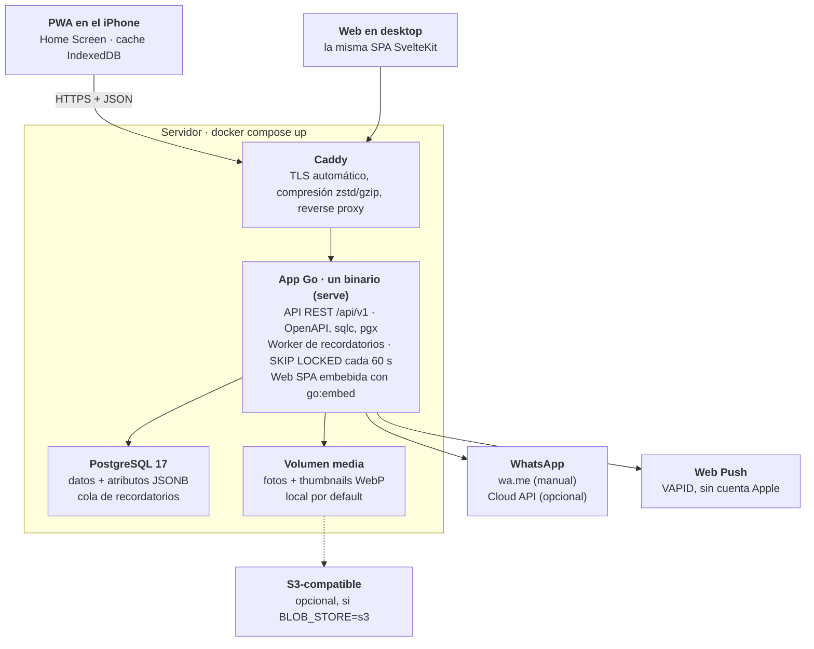

# SAD — Sistema de citas para emprendimientos

Oct 23, 2026 · jnaranj09

## Contexto, drivers y restricciones

La arquitectura es un monolito modular en Go sobre PostgreSQL, empaquetado como un solo binario y desplegado con Docker Compose. Cada decisión de este documento se justifica contra estos drivers, en orden de prioridad:

1. **Performance percibida:** la app debe sentirse instantánea (p95 API < 50 ms, ver PRD NFR-1 a NFR-3).
2. **Self-hosting trivial:** `docker compose up` en un VPS de 1 vCPU y 1 GB RAM, sin pasos manuales.
3. **Flexibilidad de atributos:** tipos y sub-opciones definidos por la owner sin migraciones de schema.
4. **Mantenible por una persona:** pocas piezas, sin servicios que se puedan evitar.

**Restricciones**

- Un solo negocio por instalación; no hay multi-tenancy comercial.
- Volumen esperado pequeño: miles de clientas y decenas de miles de citas, no millones.
- WhatsApp: el envío automático depende de templates pre-aprobados por Meta; el modo manual asistido no depende de nadie.
- Open source: nada de servicios pagos obligatorios; todo lo externo (S3, WhatsApp, Web Push) es opcional o tiene fallback local.

## Vista de contexto y contenedores

Todo el sistema corre en un host con tres contenedores: Caddy, la app Go y PostgreSQL. Los servicios externos son opcionales y el sistema funciona completo sin ellos.



El iPhone y el desktop corren la misma SPA, que habla el contrato OpenAPI a través de Caddy; en modo manual, el envío por WhatsApp sale del teléfono de la owner vía `wa.me`, no del servidor. El contenedor de backup (perfil opcional) no se dibuja.

## Stack tecnológico y decisiones (ADRs)

Go + PostgreSQL, con el web client embebido en el mismo binario: una instalación son tres contenedores (app, postgres, caddy).

| ADR | Decisión | Elegido | Descartado | Por qué |
| --- | --- | --- | --- | --- |
| 001 | Lenguaje backend | Go | Spring Boot, Node | Binario estático de ~20 MB, arranque en ms, ~30 MB de RAM; ideal para un VPS chico y sin warm-up de JVM |
| 002 | Base de datos | PostgreSQL 17+ | SQLite, MongoDB | JSONB + GIN para atributos, `SKIP LOCKED` para la cola de recordatorios, FTS y `pg_trgm` para búsqueda |
| 003 | Acceso a datos | `pgx` v5 + `sqlc` | GORM, ent | SQL escrito a mano y tipado en compile time; cero reflection en el hot path |
| 004 | Contrato API | OpenAPI 3.1, spec-first con `oapi-codegen` | Code-first, GraphQL | Un spec genera el server Go y el cliente TypeScript |
| 005 | Arquitectura | Monolito modular, un binario con modos `api` y `worker` | Microservicios | Una persona lo mantiene; los módulos se pueden separar después si hiciera falta |
| 006 | Cola de jobs | Tabla en Postgres + `FOR UPDATE SKIP LOCKED` | RabbitMQ, Redis | Una pieza menos que operar; el volumen es de decenas de mensajes por día |
| 007 | Migraciones | `goose` embebido, corre al arrancar | Paso manual | Cumple "cero pasos manuales en DB" (NFR-4) |
| 008 | Cliente único | SvelteKit con `adapter-static`, embebido con `go:embed`, instalable como PWA | React + Next.js, SSR | Bundle chico, sin servidor Node aparte; la misma SPA sirve en desktop y en el iPhone |
| 009 | iOS | PWA instalada en Home Screen (ver ADR 015) | App nativa SwiftUI con xtool | Sin Mac, sin App Store, sin cuenta Apple Developer; un solo código de cliente |
| 010 | Storage de imágenes | Volumen local por default; S3-compatible opcional | Solo S3 | Self-hosting sin cuentas externas; una interface `BlobStore` con dos implementaciones |
| 011 | Reverse proxy | Caddy | Nginx, Traefik | TLS automático con Let's Encrypt en una línea de config; HTTPS es requisito para service workers |
| 012 | Auth | Sesiones opacas en Postgres + Argon2id, en cookie | JWT, Keycloak | Revocables, simples, sin otro servicio; Keycloak es demasiado para un negocio |
| 013 | Templates de mensajes | Renderer propio tipo Mustache (`{{client.key}}`) | `text/template` de Go | El texto lo escribe la owner: sin lógica, sin acceso a funciones, errores amigables |
| 014 | Licencia | Pendiente: MIT o AGPL-3.0 | — | AGPL evita forks SaaS cerrados; MIT maximiza adopción |
| 016 | Push | Web Push estándar con VAPID | APNs nativo | Funciona en PWAs de iOS 16.4+ sin cuenta Apple; las llaves se generan solas |

### ADR 015 — PWA en vez de app nativa

No hay app nativa: la owner instala el web client en su iPhone desde Safari (Share → Add to Home Screen) y corre en standalone, sin la barra de Safari. Reemplaza el plan anterior de SwiftUI con xtool.

- **Qué se gana:** un solo cliente que mantener, deploy instantáneo (sin review de App Store), y cero dependencia de Mac o de la cuenta Apple Developer. Para un proyecto open source, cualquier self-hoster tiene "app" sin publicar nada.
- **Qué funciona en iOS:** Web Push y badges en el ícono desde iOS 16.4, siempre que la PWA esté instalada y la owner dé permiso con un tap. Storage amplio en IndexedDB con Persistent Storage API desde Safari 17. iOS 26 abre por default como web app lo que se agrega al Home Screen.
- **Qué no funciona:** no hay prompt automático de instalación (`beforeinstallprompt`), no hay background sync confiable, y el push no existe en una pestaña normal de Safari.
- **Diseño resultante:** pantalla de onboarding que detecta iOS no instalado y muestra los pasos para instalar; el servidor es la fuente de verdad y IndexedDB es solo cache; los recordatorios dependen del worker del server, nunca del teléfono.
- **Revisar si:** la owner necesita algo que solo da una app nativa (widgets, Siri, background real). En ese caso, la API y el contrato OpenAPI no cambian.

### ADR 017 — IA on-device opcional

Las features de IA corren en el browser con [runonweb](https://runonweb.ai/) (WebGPU, con fallback a WASM), no en una API en la nube. Así no hay costo de servidor ni API keys que configurar, y las fotos y notas de las clientas nunca salen del teléfono. La IA es un acelerador de captura de datos, nunca una dependencia: la app funciona completa sin ella.

| Feature | Módulo | Descarga | Fase |
| --- | --- | --- | --- |
| Migrar la libreta: foto de la agenda → clientas y teléfonos propuestos | Scan (OCR) | ~31 MB | 2 |
| Comprobante de SINPE Móvil → método de pago y monto de la cita | Scan (OCR) | (mismo modelo) | 2 |
| Dictar notas de la cita | Scribe (Whisper) | ~44–154 MB | 2 (probado en español) |
| Quitar el fondo de fotos de diseños para portfolio | Remover (BEN2) | ~219 MB | 3 |
| Etiquetar la galería con captions en español | Alt (captioning) | ~548 MB | 3 |

**Reglas de implementación**

- **Fuera del camino crítico:** cada módulo se carga con lazy-load al tocar "Escanear" o "Dictar", nunca al abrir la app.
- **Humano en el loop:** el OCR propone y la owner confirma; nada se guarda sin revisión.
- **Interface propia** (`Ocr`, `Dictation`, `BackgroundRemover`) para cambiar de librería sin tocar la app; runonweb está en v0.1.0.
- **Descarga explícita:** la primera vez se muestra el tamaño y se recomienda Wi-Fi; si iOS borra el cache, se vuelve a bajar sin romper nada.
- **Feature detection:** WebGPU → WASM → la feature se oculta si el dispositivo no la soporta.
- **Validar en un iPhone real** antes de habilitar cada módulo: los benchmarks publicados son de una laptop M-series en Chrome, y la memoria de una PWA en iOS es limitada.
- **Licencias:** el código de runonweb es MIT, pero cada modelo conserva la licencia de sus autores; se revisa antes de incluirlo en el repo.

## Modelo de datos

Las entidades fijas son tablas normales; los valores de atributos viven en una columna `JSONB` validada por la API contra `attribute_definitions`. Así la owner crea atributos nuevos sin migraciones y las queries siguen siendo rápidas con índices GIN.

**Decisiones del modelo**

- IDs `UUIDv7` generados en Go: ordenables por tiempo, útiles como cursor de paginación y seguros para crear offline desde la PWA.
- `attrs` se indexa por la `key` del atributo (`{"bebida_favorita": "Café negro"}`). La `key` es inmutable después de crearse, porque los templates dependen de ella.
- Las opciones se guardan por ID (`{"forma": ["opt_almendra", "opt_corta"]}`), así renombrar una opción no rompe datos históricos.
- Sub-opciones: `attribute_options.parent_id` forma un árbol; la API valida que el valor elegido sea una ruta válida.
- Archivado lógico (`archived_at`) en clientas, servicios y atributos; nada se borra por accidente.
- Timestamps `timestamptz` en UTC; la timezone del negocio vive en `business_settings`.

```sql
CREATE TABLE business_settings (
  id          smallint PRIMARY KEY DEFAULT 1 CHECK (id = 1),
  name        text NOT NULL,
  timezone    text NOT NULL DEFAULT 'America/Costa_Rica',
  locale      text NOT NULL DEFAULT 'es-CR',
  whatsapp_mode text NOT NULL DEFAULT 'manual'  -- manual | cloud_api
);

CREATE TABLE attribute_definitions (
  id          uuid PRIMARY KEY,
  key         text NOT NULL UNIQUE,            -- inmutable, usada en templates
  label       text NOT NULL,
  scope       text NOT NULL CHECK (scope IN ('client','appointment')),
  type        text NOT NULL CHECK (type IN ('text','number','date','select',
                'multiselect','payment_method','image')),
  required    boolean NOT NULL DEFAULT false,
  position    int NOT NULL,
  archived_at timestamptz
);

CREATE TABLE attribute_options (
  id           uuid PRIMARY KEY,
  attribute_id uuid NOT NULL REFERENCES attribute_definitions(id),
  parent_id    uuid REFERENCES attribute_options(id),   -- sub-opciones
  label        text NOT NULL,
  position     int NOT NULL,
  archived_at  timestamptz
);

CREATE TABLE clients (
  id          uuid PRIMARY KEY,
  name        text NOT NULL,
  phone_e164  text,                               -- +50688887777
  notes       text,
  attrs       jsonb NOT NULL DEFAULT '{}',
  created_at  timestamptz NOT NULL DEFAULT now(),
  updated_at  timestamptz NOT NULL DEFAULT now(),
  archived_at timestamptz
);
CREATE INDEX clients_name_trgm ON clients USING gin (name gin_trgm_ops);
CREATE INDEX clients_attrs_gin ON clients USING gin (attrs jsonb_path_ops);

CREATE TABLE services (
  id           uuid PRIMARY KEY,
  name         text NOT NULL,
  duration_min int  NOT NULL,
  price_cents  int,
  color        text,
  archived_at  timestamptz
);

CREATE TABLE service_attributes (                 -- FR-A6
  service_id   uuid REFERENCES services(id),
  attribute_id uuid REFERENCES attribute_definitions(id),
  PRIMARY KEY (service_id, attribute_id)
);

CREATE TABLE appointments (
  id          uuid PRIMARY KEY,
  client_id   uuid NOT NULL REFERENCES clients(id),
  starts_at   timestamptz NOT NULL,
  ends_at     timestamptz NOT NULL,
  status      text NOT NULL DEFAULT 'scheduled',
  attrs       jsonb NOT NULL DEFAULT '{}',
  notes       text,
  version     int NOT NULL DEFAULT 1             -- optimistic locking
);
CREATE INDEX appointments_day ON appointments (starts_at) WHERE status <> 'cancelled';
CREATE INDEX appointments_client ON appointments (client_id, starts_at DESC);

CREATE TABLE appointment_services (
  appointment_id uuid REFERENCES appointments(id) ON DELETE CASCADE,
  service_id     uuid REFERENCES services(id),
  PRIMARY KEY (appointment_id, service_id)
);

CREATE TABLE media (
  id             uuid PRIMARY KEY,
  client_id      uuid REFERENCES clients(id),
  appointment_id uuid REFERENCES appointments(id),
  storage_key    text NOT NULL,                   -- local path o S3 key
  thumb_key      text NOT NULL,
  content_type   text NOT NULL,
  created_at     timestamptz NOT NULL DEFAULT now()
);

CREATE TABLE reminder_rules (
  id          uuid PRIMARY KEY,
  service_id  uuid NOT NULL REFERENCES services(id),
  anchor      text NOT NULL CHECK (anchor IN ('before_start','after_completed')),
  offset_min  int  NOT NULL,                      -- 1440 = 24 h; 30240 = 21 d
  recipient   text NOT NULL CHECK (recipient IN ('client','owner')),
  template    text NOT NULL,
  skip_if_future_booking boolean NOT NULL DEFAULT true   -- FR-R7
);

CREATE TABLE reminders (                          -- outbox / cola
  id             uuid PRIMARY KEY,
  rule_id        uuid NOT NULL REFERENCES reminder_rules(id),
  appointment_id uuid NOT NULL REFERENCES appointments(id),
  due_at         timestamptz NOT NULL,
  status         text NOT NULL DEFAULT 'pending', -- pending|ready|sent|skipped|failed
  rendered_body  text,
  sent_via       text,                            -- manual | cloud_api
  attempts       int NOT NULL DEFAULT 0,
  UNIQUE (rule_id, appointment_id)                -- idempotencia
);
CREATE INDEX reminders_due ON reminders (due_at) WHERE status = 'pending';
```

Las tablas `users` y `sessions` se describen en Seguridad.

## Diseño de la API

REST + JSON bajo `/api/v1`, definida en `openapi.yaml` como única fuente de verdad. El CI falla si el spec y el código generado no coinciden.

| Recurso | Endpoints principales | Notas |
| --- | --- | --- |
| Auth | `POST /auth/login`, `POST /auth/logout`, `GET /me` | Devuelve token opaco |
| Clients | `GET/POST /clients`, `GET/PATCH /clients/{id}`, `GET /clients?q=` | `q` usa `pg_trgm` para búsqueda mientras se escribe |
| Attributes | `GET/POST /attributes`, `PATCH /attributes/{id}`, `POST /attributes/{id}/options` | El GET devuelve el árbol de opciones completo |
| Services | `GET/POST /services`, `PATCH /services/{id}`, `PUT /services/{id}/reminder-rules` | Las reglas se reemplazan en bloque |
| Appointments | `GET /appointments?from=&to=`, `POST /appointments`, `PATCH /appointments/{id}`, `POST /appointments/{id}/complete` | `complete` dispara los recordatorios `after_completed` |
| Media | `POST /media` (multipart), `GET /media/{id}/thumb`, `GET /media/{id}` | Thumbnails generados al subir |
| Reminders | `GET /reminders?status=ready`, `POST /reminders/{id}/mark-sent`, `GET /reminders/{id}/preview` | Bandeja "Para enviar hoy"; `POST /push/subscriptions` registra la PWA para Web Push |
| Templates | `POST /templates/preview` | Renderiza un template contra una clienta de ejemplo |
| Sync | `GET /sync?since=<cursor>` | Deltas para la cache local de la PWA |
| Export | `GET /export` | ZIP con JSON + CSV + fotos |

**Convenciones**

- Paginación por cursor con el UUIDv7 (`?after=<id>&limit=50`), nunca por offset.
- `PATCH` con optimistic locking: el cliente manda `If-Match: <version>` y recibe `409` si alguien cambió la cita.
- Errores en formato RFC 9457 (`application/problem+json`) con `field` para errores de validación de atributos.
- `ETag` en lecturas de catálogo (servicios, atributos) para respuestas `304` baratas.
- Idempotency-Key en `POST` para que un reintento desde el celular con mala señal no duplique citas.

## Motor de recordatorios y templates

Los recordatorios se materializan como filas en `reminders` en la misma transacción que crea o cambia la cita (outbox pattern), y un worker las procesa con `SKIP LOCKED`. Nunca se pierde uno aunque el proceso se reinicie.

**Ciclo de vida**

1. **Materializar.** Al crear o reagendar una cita, la API calcula `due_at` para cada regla `before_start` de sus servicios e inserta las filas `pending`. Al completar la cita hace lo mismo con las reglas `after_completed`. El `UNIQUE (rule_id, appointment_id)` hace la operación idempotente.
2. **Recalcular.** Reagendar actualiza `due_at` de los pendientes; cancelar los pasa a `skipped`.
3. **Despertar.** El worker corre cada 60 s: `SELECT … WHERE status = 'pending' AND due_at <= now() FOR UPDATE SKIP LOCKED LIMIT 50`.
4. **Filtrar.** Si la regla tiene `skip_if_future_booking` y la clienta ya tiene una cita futura de ese servicio, pasa a `skipped` (FR-R7).
5. **Renderizar.** Se resuelve el template contra la clienta, la cita y el negocio, y se guarda en `rendered_body`. Así lo que se ve en el preview es exactamente lo que se envía.
6. **Entregar.** En modo `manual` pasa a `ready`, aparece en la bandeja y dispara un push a la owner. En modo `cloud_api` se envía por Meta con reintentos y backoff; si falla 3 veces, cae a `ready` como fallback manual.
7. **Cerrar.** El tap en "Enviar" abre `https://wa.me/<phone>?text=<url-encoded body>`; al volver, la app marca `sent`.

**Templates**

- Sintaxis: `{{client.name}}`, `{{client.bebida_favorita}}`, `{{appointment.date}}`, `{{appointment.time}}`, `{{services}}`, `{{business.name}}`.
- Fallback por variable: `{{client.bebida_favorita | "un cafecito"}}` cuando la clienta no tiene el atributo.
- Las opciones se renderizan por su label actual; las fechas, en la timezone y el locale del negocio ("sábado 24 de octubre, 3:00 p. m.").
- Validación al guardar la regla: toda variable debe existir en `attribute_definitions` o en el set fijo; si no, error con la `key` sugerida más cercana.
- Para `cloud_api`, cada regla se mapea a un template aprobado por Meta y las variables a sus slots `{{1}}`, `{{2}}`; el texto libre solo se permite dentro de la ventana de 24 h de conversación.

## Performance

La velocidad se gana en tres capas: cache local en el cliente, queries indexadas en el server y payloads chicos en el cable. La más importante es la primera, porque la latencia más rápida es la que no ocurre.

**Cliente (lo que la owner siente)**

- La PWA lee siempre de IndexedDB primero y refresca en background con `GET /sync?since=`. Abrir "Hoy" no espera la red (NFR-2).
- Optimistic UI: crear o editar una cita se refleja al instante y se reconcilia con la respuesta; un `409` muestra el conflicto.
- Búsqueda de clientas local sobre la cache, con fallback a `GET /clients?q=` si no hay match (NFR-3).
- Thumbnails WebP de ~20 KB en listas; la foto completa solo al abrirla.
- Service worker con precache del app shell; assets hasheados y `Cache-Control: immutable`; después de la primera carga solo viaja JSON.

**Server**

- `pgxpool` con prepared statements; `sqlc` sin reflection.
- Cada pantalla es una sola query o un `pgx.Batch`; nada de N+1. "Hoy" trae citas, clientas y servicios en un round-trip.
- Catálogos (servicios, atributos y su árbol de opciones) cacheados en memoria e invalidados al escribir, ya que hay una sola instancia.
- Respuestas con gzip o zstd vía Caddy; JSON sin campos nulos.
- Generación de thumbnails al subir, fuera del request en una goroutine con límite de concurrencia.

**Medición**

- Middleware con histogramas de latencia por ruta en `/metrics` (formato Prometheus, opcional).
- `EXPLAIN ANALYZE` de las queries principales en CI contra un seed de 10,000 clientas y 100,000 citas; falla si alguna pasa de 10 ms.
- Presupuesto: p95 < 50 ms en lecturas (NFR-1), con alarma en el benchmark si se rompe.

## Seguridad y autenticación

Auth propio y simple: usuarios con password Argon2id y sesiones opacas guardadas hasheadas en Postgres. Los datos de clientas (teléfonos, fotos) son personales, así que todo pasa por HTTPS y nada es público por default.

```sql
CREATE TABLE users (
  id            uuid PRIMARY KEY,
  email         text NOT NULL UNIQUE,
  password_hash text NOT NULL,          -- Argon2id
  role          text NOT NULL DEFAULT 'owner'  -- owner | staff (fase 3)
);

CREATE TABLE sessions (
  token_hash  bytea PRIMARY KEY,        -- SHA-256 del token; el token nunca se guarda
  user_id     uuid NOT NULL REFERENCES users(id),
  device      text,                     -- "iPhone de Ana", "Web"
  expires_at  timestamptz NOT NULL,
  last_seen_at timestamptz NOT NULL DEFAULT now()
);
```

- **Primer arranque:** si no hay usuarios, el binario imprime un link de setup de un solo uso en los logs (patrón de Gitea y Grafana) para crear la owner.
- **Tokens:** 32 bytes aleatorios; viajan en una cookie `HttpOnly`, `Secure`, `SameSite=Strict`.
- **Expiración:** sliding de 90 días. La PWA instalada tiene cookies y storage separados de Safari, así que la owner inicia sesión una vez dentro de la PWA; la owner puede cerrar sesiones por dispositivo.
- **Rate limiting** en `/auth/login` (5 intentos por minuto por IP) dentro del mismo binario.
- **Media:** nunca servida por URL pública; `GET /media/{id}` exige sesión, o una URL firmada de corta vida si el storage es S3.
- **Secretos** (token de Meta, credenciales S3) solo por variables de entorno o Docker secrets, nunca en la DB ni en el repo.
- **Headers:** CSP estricta para la SPA, HSTS desde Caddy.
- **Supply chain:** `govulncheck` y Dependabot en CI; imágenes base `distroless` sin shell.

## Despliegue con Docker Compose, backups y operación

Instalar es copiar dos archivos, editar el dominio y correr `docker compose up -d`. El comando `serve` del binario corre API, worker y web en un solo proceso; los modos `api` y `worker` existen por si alguien quiere separarlos.

```yaml
# docker-compose.yml
services:
  app:
    image: ghcr.io/<org>/<proyecto>:latest
    command: ["serve"]
    env_file: .env
    volumes:
      - media:/data/media
    depends_on:
      db:
        condition: service_healthy
    restart: unless-stopped

  db:
    image: postgres:17-alpine
    environment:
      POSTGRES_DB: citas
      POSTGRES_USER: citas
      POSTGRES_PASSWORD: ${DB_PASSWORD}
    volumes:
      - pgdata:/var/lib/postgresql/data
    healthcheck:
      test: ["CMD", "pg_isready", "-U", "citas"]
      interval: 5s
    restart: unless-stopped

  caddy:
    image: caddy:2-alpine
    ports: ["80:80", "443:443"]
    volumes:
      - ./Caddyfile:/etc/caddy/Caddyfile:ro
      - caddy_data:/data
    restart: unless-stopped

  backup:                      # opcional: docker compose --profile backup up -d
    image: postgres:17-alpine
    profiles: ["backup"]
    entrypoint: ["/scripts/backup.sh"]   # pg_dump diario + tar de media, rotación por días
    volumes:
      - ./scripts:/scripts:ro
      - ./backups:/backups
      - media:/data/media:ro

volumes: { pgdata: {}, media: {}, caddy_data: {} }
```

```text
# Caddyfile
citas.midominio.com {
  encode zstd gzip
  reverse_proxy app:8080
}
```

**Configuración (`.env`)**

| Variable | Default | Para qué |
| --- | --- | --- |
| `DATABASE_URL` | — | Conexión a Postgres |
| `PUBLIC_URL` | — | URL base para links, cookies y el manifest de la PWA |
| `BLOB_STORE` | `local` | `local` o `s3` |
| `S3_ENDPOINT`, `S3_BUCKET`, `S3_KEY`, `S3_SECRET` | — | Solo si `BLOB_STORE=s3` |
| `WHATSAPP_MODE` | `manual` | `manual` o `cloud_api` |
| `WHATSAPP_TOKEN`, `WHATSAPP_PHONE_ID` | — | Solo con `cloud_api` |
| `VAPID_PUBLIC_KEY`, `VAPID_PRIVATE_KEY` | Generadas al primer arranque | Web Push; se guardan en la DB si no vienen por env |
| `BACKUP_RETENTION_DAYS` | `14` | Rotación de backups |

**Operación**

- **Upgrade:** `docker compose pull && docker compose up -d`; las migraciones corren solas al arrancar y el binario no levanta si una falla.
- **Antes de migrar:** `scripts/upgrade.sh` corre un `pg_dump` con el contenedor de backup si el perfil `backup` está activo.
- **Restore:** `scripts/restore.sh <archivo>` documentado y probado en CI (Fase 2).
- **Imágenes multi-arch** (`amd64` + `arm64`) para correr en un VPS cualquiera o en una Raspberry Pi.
- **Health:** `GET /healthz` (vivo) y `GET /readyz` (DB y migraciones OK).
- **Logs** estructurados en JSON a stdout con `slog`.

## Riesgos y preguntas abiertas

| Riesgo | Impacto | Mitigación |
| --- | --- | --- |
| Meta rechaza o encarece los templates de WhatsApp | Sin envío automático | El modo manual asistido es el default y funciona siempre |
| Pérdida de datos en un VPS sin mantenimiento | Se pierde el negocio de la owner | Perfil `backup` documentado como paso 2 de la instalación; restore probado en CI |
| El JSONB de atributos se llena de valores inválidos | Datos inconsistentes, templates rotos | Validación estricta en la API y un job semanal que reporta valores huérfanos |
| Conflictos de sync entre el iPhone y el desktop | Citas sobrescritas | Optimistic locking con `version` + `409` visible en la UI |
| Scope creep hacia un SaaS completo | El MVP nunca sale | No-objetivos explícitos en el PRD; gate de 4 semanas de uso real |
| La owner usa la PWA desde una pestaña de Safari sin instalarla | Sin push y con storage menos estable | Onboarding que detecta el modo y guía la instalación; el push se pide solo dentro de la PWA instalada |
| iOS borra el cache de IndexedDB | Primera carga lenta | Persistent Storage API; el server es la fuente de verdad y el cache se reconstruye con `/sync` |

**Preguntas abiertas**

- [ ] ¿Dominio propio para la PWA desde el día uno? Cambiar el dominio después obliga a reinstalarla y a iniciar sesión de nuevo.
- [ ] ¿MIT o AGPL-3.0 (ADR 014)?
- [ ] ¿PostgreSQL 17 o 18? 18 trae `uuidv7()` nativo, pero 17 tiene más tiempo en producción.
- [ ] ¿Qué tan offline debe ser la PWA: solo lectura, o también crear citas sin señal y sincronizar después?
