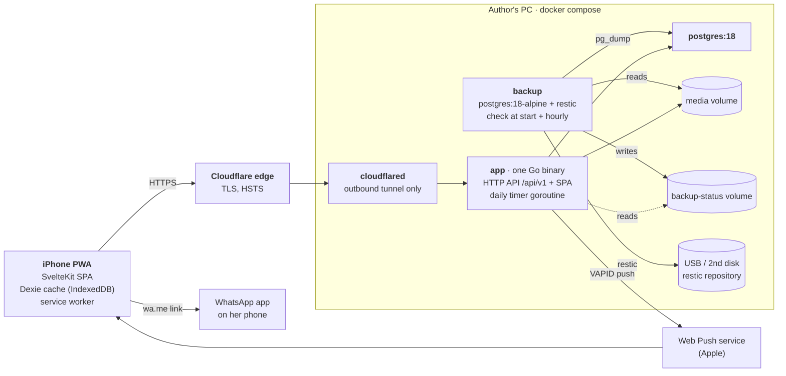
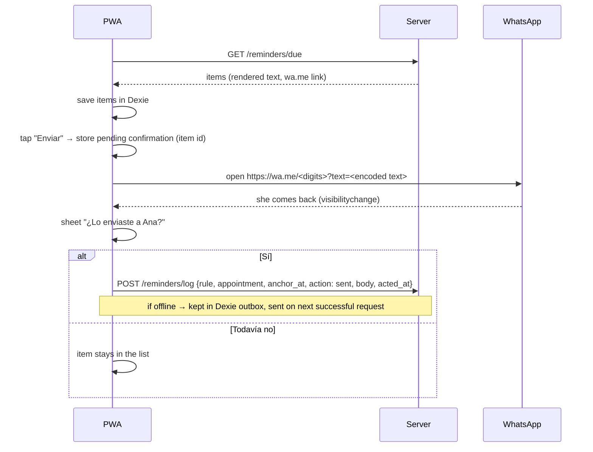

# open-customer — Release 1

*   **Author:** jnaranj09
*   **Status:** Draft
*   **Date:** 2026-10-30
*   **Predecessors:** [concepts_brief.md](./concepts_brief.md), [PRD](./PRD%20—%20Sistema%20de%20citas%20para%20emprendimientos.md), [SAD](./SAD%20—%20Sistema%20de%20citas%20para%20emprendimientos.md)

--------------------------------------------------------------------------------

## Overview

open-customer is an open-source, self-hosted app to manage clients, appointments and WhatsApp reminders for a small service business.

Release 1 is built for one real user: the owner of a nail studio that is already open.
She is not technical and works from her iPhone, often with one hand busy.
She gets an empty app, installs it on her Home Screen, and sets up her own services, client attributes and reminder messages without code.

The core value is personal reminders.
A message like "Aquí te esperamos con tu café negro" is built from attributes she defined herself.
The app also reminds clients to come back for a fill (relleno) a set number of days after a visit.

Everything that can be generic stays generic: attributes, branding, templates, time zone, currency, country code.
Another business (barber, spa, tattoo studio) can run the same code with its own setup.

The first install runs on the author's home PC behind a Cloudflare Tunnel.
The PC is sometimes off. The owner accepts that downtime. The app must behave in a clear way while the server is off.

Priorities when goals conflict, in order:

1.  Her daily use and her ability to set it up herself.
2.  Data safety.
3.  Reminders are correct.
4.  Maintainable by one person.
5.  Generic and self-hostable by others.

This document replaces the architecture parts of the SAD for release 1.
The PRD keeps the "what" and "why"; it will be updated to match this document (see Detailed Implementation).

## The Problem

Today she keeps clients, appointments and reminders across WhatsApp chats, a notebook and her memory.
Because of that:

*   Reminders depend on her remembering. Clients miss appointments, and come-back visits are not booked on time.
*   Details she knows about each client (favorite drink, nail shape, allergies) are not written anywhere she can search, and are never used in messages.
*   Nothing tells her which messages she should send today.

Existing tools do not fit:

*   **SaaS** (AgendaPro, Fresha, Booksy): custom fields are limited and usually cannot be used inside messages. Data lives on someone else's platform, with a monthly fee and paid SMS.
*   **Free self-hosted tools** (Easy!Appointments, Cal.com, Odoo Appointments): built around public booking pages, heavy to run, and weak at putting custom fields into messages.
*   **General CRMs** (Twenty, EspoCRM): not built for appointments or for one-hand use on an iPhone.

The gap is the combination: her own attributes, used inside her own messages, set up by her from a phone.

Proposed solution, in short:

*   A Go server with PostgreSQL 18, and a SvelteKit web app embedded in the same binary and installed as a PWA on her iPhone.
*   The server computes the list of messages to send today from her rules and appointments.
*   She sends each one with a tap that opens WhatsApp with the text and number filled in (`wa.me`), then confirms it was sent.
*   One push notification per day tells her how many messages are waiting.

## Goals

Each goal has a check. Release 1 is done when all checks pass.

1.  **She sets up the empty app herself.**
    Check: on her own iPhone, without help, she creates her services, at least 5 attributes and one reminder template in under 20 minutes.
2.  **Booking is fast.**
    Check: creating an appointment with client, service(s), date and attributes takes under 30 seconds for an existing client.
3.  **Reminders are correct.**
    Checks:
    *   More than 95% of due reminders appear in "Para enviar hoy" on their due day, counted over days when the server was on.
    *   A "before the appointment" reminder is never shown after the appointment has started.
    *   A come-back reminder is never missing because she forgot to mark an appointment as done.
    *   A client with several services on one appointment gets one "before" message, not one per service.
    *   A client who already has a future booking does not get a come-back reminder.
4.  **She uses it every working day.**
    Check: 4 weeks of daily use without going back to the notebook (the PRD's gate to Phase 2).
5.  **Her data is safe and is hers.**
    Checks:
    *   A backup runs every day the PC is on, and a copy lands on a second disk or machine.
    *   One full restore on a clean install succeeds before her real data goes in.
    *   She can download her data as CSV + JSON from the app, without the author.
6.  **It feels fast, and it is clear when the server is off.**
    Checks:
    *   The "Hoy" screen opens in under 1 second on her iPhone over LTE through the tunnel.
    *   With the server off, "Hoy" opens from the phone's cache, shows a "server off" banner with the last sync time, and never shows a change as saved when it was not.
7.  **Nothing business-specific is hardcoded.**
    Check: no nail, Costa Rica or Spanish-only value lives in code or migrations as data. Time zone, currency, country code, business name, branding, services, attributes and templates are all set in the app.
8.  **One person can run it.**
    Check: the install is one Compose file with four services (app, postgres, cloudflared, backup), no published ports, pinned image tags, and upgrades that take a backup first.

## Non-Goals

*   **WhatsApp Cloud API** (automatic sending through Meta). Release 1 is manual send through `wa.me`. Data fields stay compatible with adding it later.
*   **A reminders queue and background worker.** The list is computed when read. A queue comes back with the Cloud API.
*   **Creating or editing data while the server is off.** Release 1 is read-only offline. No conflict merge, no delta sync.
*   **On-device AI** (notebook OCR, receipt reading, dictation, background removal, photo tags). iOS already covers dictation and text capture.
*   **Scale and multi-host features:** S3 storage, separate API and worker processes, Prometheus metrics, query-time gates in CI, a p95 latency target for the server, multi-architecture images, ETag caching, in-memory caches, JSONB indexes.
*   **Caddy and Let's Encrypt** for the reference install. Kept only as an optional profile for people who self-host on a VPS.
*   **Photos in the export.**
*   **Hard delete.** Records are archived. A deletion request is handled by the author with SQL.
*   **Image attribute type, deep option trees, attributes limited to some services**, unless the interview with her shows a need.
*   **Staff accounts, public booking, English UI, reports, preset packs per business type.**
*   **"A stranger installs it in 10 minutes"**, VPS sizing targets and contributor readiness. These move to the Phase 3 gate.
*   **Restore tests in CI.** Release 1 has one manual restore drill.
*   **Choosing the license.** Decided before the repo goes public.

## Open Questions

*   **Her real attributes and services**: Which attributes does she track per client and per appointment? Which services does she offer, and after how many days does each client come back? Source: a one-hour interview with her. This decides whether sub-options are needed and which starter templates to ship.
*   **WhatsApp link behavior on her iPhone**: Does `wa.me` opened from the installed PWA go straight to WhatsApp or through Safari? Does `whatsapp://send` behave better? Do accents, emoji and line breaks survive? Which app opens if both WhatsApp and WhatsApp Business are installed? Source: a test page on her iPhone through the tunnel.
*   **PostgreSQL 18 Docker image data path**: A reviewer reported that the `postgres:18` image changed where data is stored. Check before writing the Compose file.
*   **Exact subdomain**: Which subdomain of the author's domain. Must be fixed before she installs the PWA.
*   **iOS behavior to confirm on her device**: whether iOS updates the Home Screen icon and name after install; whether Safari's photo picker always gives JPEG instead of HEIC; whether a `SameSite=Lax` session cookie is sent when she opens the app from a push notification.
*   **Cloudflare limits**: the current free-plan upload size limit and response timeout, which affect photo upload and export.
*   **Costa Rica Ley 8968**: whether archive-only deletion meets her obligations for client personal data.

## Critical User Journeys (CUJs)

### CUJ 1: Handover and first setup

*   **Given**: The author has started the Compose stack on his PC. The tunnel points the chosen subdomain at the app. The database is empty.
*   **When**:
    1.  The author copies the one-time setup link from the app logs and opens it with her, on her iPhone in Safari.
    2.  The setup wizard asks for business name, time zone, currency, country code, accent color and icon. Then it asks for her username and password.
    3.  The wizard shows the iOS install steps (Share → Add to Home Screen).
    4.  She opens the installed app. It shows the login screen. She logs in with her username and password.
    5.  The app asks permission for the daily notification, and she taps Allow.
*   **Then**:
    *   The installed app shows her business name and icon.
    *   She has a session in the installed app (separate from Safari).
    *   One push subscription is stored.
    *   The setup link no longer works.

### CUJ 2: She configures the empty app

*   **Given**: Setup is done. The app has the starter content only: one "before the appointment" rule with an editable message, a "Método de pago" attribute with SINPE / Efectivo / Tarjeta, and a built-in sample client used for previews.
*   **When**: She creates services (name, duration, price, color), client attributes ("Bebida favorita", text) and appointment attributes ("Forma", select). Then she edits the reminder message by tapping variable chips ("+ Bebida favorita") and adds a come-back rule to "Acrílico": "21 días después, enviar plantilla 'Relleno'".
*   **Then**:
    *   Each attribute gets a hidden key generated from its label.
    *   The message editor shows a live preview against the sample client.
    *   She never sees `{{ }}` syntax, keys, "scope" or "offset".
    *   All of this works on her iPhone, one screen at a time.

### CUJ 3: Booking an appointment

*   **Given**: The client "Ana" exists. The server is on.
*   **When**: She opens "Hoy", taps "+", searches "ana" (finds "Ána" too), picks "Acrílico" and "Pedicure", picks Saturday 3:00 p.m. and sets "Forma: Almendra".
*   **Then**:
    *   The appointment is saved, with the two services' prices and durations copied into it.
    *   The end time is the sum of the durations.
    *   If it overlaps another appointment, she sees a warning and can choose "Agendar igual".
    *   The whole flow takes under 30 seconds.

### CUJ 4: Morning sending

*   **Given**: Ana's appointment is tomorrow at 3:00 p.m. The "before" rule is 24 h. Her push time is 8:00. The server is on at 8:00.
*   **When**:
    1.  At 8:00 her phone shows "Tienes 3 mensajes para enviar hoy".
    2.  She taps it. The app opens on "Para enviar hoy". She taps "Enviar" on Ana's item.
    3.  WhatsApp opens with Ana's number and the rendered message.
    4.  She sends it and returns to the app.
*   **Then**:
    *   The app asks "¿Lo enviaste a Ana?".
    *   She taps "Sí". The item moves to "Enviados" with the exact text that was sent.
    *   The app moves to the next item.

### CUJ 5: Come-back reminder lifecycle

*   **Given**: Ana had "Acrílico" on October 1, ending at 4:00 p.m. "Acrílico" has a 21-day come-back rule. Nobody tapped anything after the appointment.
*   **When**: October 22 arrives.
*   **Then**:
    *   The come-back message for Ana appears in "Para enviar hoy", because the appointment time passed and it was not cancelled.
    *   If Ana had booked any later appointment, the message does not appear.
    *   If that later appointment is cancelled, the message appears again.
    *   If Ana did not come on October 1 and the owner marks "No vino", the message never appears.

### CUJ 6: Server off

*   **Given**: The PC is off. She used the app yesterday.
*   **When**: She opens the app.
*   **Then**:
    *   "Hoy" shows yesterday's cached data at once.
    *   A banner says "El sistema está apagado. Datos de las 18:42."
    *   "+" and edit buttons explain that changes need the server.
    *   A form she had started is kept as a draft.
    *   She can still open cached "Para enviar hoy" items and send them through WhatsApp. Her "Sí, lo envié" taps are stored on the phone and uploaded when the server is back.

### CUJ 7: Backup, upgrade and restore

*   **Given**: The USB backup disk is mounted on the PC and has the target marker file.
*   **When**: The PC has been off for two days and is turned on. Later, the author upgrades the app.
*   **Then**:
    *   As soon as the backup container starts, it sees that the last backup is older than 24 h and runs one.
    *   The app's status screen shows "Último respaldo: hoy 10:05 (USB)".
    *   During the upgrade, the upgrade script runs a backup before the new version starts.
    *   The new version will not run migrations unless a backup from the last hour exists.
    *   A restore from any of the last 14 daily copies brings back the database and the photos.

### CUJ 8: Export

*   **Given**: The server is on.
*   **When**: She opens Ajustes → "Descargar mis datos".
*   **Then**: Her phone downloads a ZIP with clients, appointments, services, attributes, templates and rules as CSV and JSON. Client and appointment attributes appear as one column each, named by their label.

## Technical Plan (Architecture)

### System view



*   No container publishes a port. cloudflared opens an outbound connection to Cloudflare, and Cloudflare routes the subdomain to `http://app:8080`.
*   TLS ends at Cloudflare. Traffic between Cloudflare and the PC goes inside the tunnel.
*   WhatsApp messages leave from her phone, not from the server.

### Process model

One binary, `open-customer`, with subcommands:

| Subcommand | What it does |
| --- | --- |
| `serve` | Runs migrations (with the backup guard below), then starts the HTTP server and the daily timer. This is the container command. |
| `create-owner` | Creates the owner user from the terminal, for installs without the setup link. |
| `reset-password <username>` | Sets a new temporary password and prints it. She must change it at next login. |
| `setup-link` | Prints a new one-time setup link if the first one expired. Works only while no user exists. |
| `healthcheck` | Calls `GET /healthz` on localhost and exits 0 or 1. Used by the Compose healthcheck, because the image has no shell. |
| `version` | Prints the build version. |

The **daily timer** is one goroutine in `serve`. Every minute it does three things:

1.  Writes a heartbeat time to `scheduler_state`.
2.  If the business-local time is past the push hour, and today's push has not been sent yet, and it is before 20:00, it counts today's due items and sends one summary push when the count is above 0. Then it records today's date in `scheduler_state`. If the PC was off at the push hour, the push goes out when the PC comes back, up to 20:00.
3.  Once per local day, it marks past `scheduled`/`confirmed` appointments as `completed` with `completed_at = ends_at`. This only keeps stored data tidy. Reminder logic never depends on it (see "Done" rule below).

There is no queue, no `SKIP LOCKED` and no retry state.

### Code layout and module rules

Monorepo. The Go module is the repo root. The web app lives in `web/`.

```text
cmd/open-customer/        main + subcommands
api/openapi.yaml          the API contract (OpenAPI 3.0.3), source of truth
internal/
  platform/               config, logging, clock, ids (UUIDv7), errors (RFC 9457)
  db/                     pgx pool, migrations (goose, embedded), sqlc output
  httpapi/                generated server interface + handlers that call domain modules
  auth/                   users, sessions, setup tokens, rate limiting, CSRF origin check
  settings/               business settings, branding, manifest, icons
  attributes/             definitions, options, value validator
  clients/                clients, phone normalization, search
  services/               service catalog
  appointments/           appointments, status rules, overlap check
  media/                  photo storage
  templates/              message templates + renderer (own Mustache-like syntax)
  reminders/              rules, due-list computation, reminder log
  push/                   VAPID keys, subscriptions, sending
  scheduler/              daily timer
  exporter/               ZIP export
  status/                 health, readiness, status screen data
  locale/                 date/number formatting, Spanish day and month names
web/                      SvelteKit app (adapter-static, Tailwind CSS v4, own components), embedded with //go:embed all:build
deploy/                   compose.yaml, .env.example, backup image, scripts
docs/                     design docs, ADRs
```

Dependency rules:

*   `httpapi` calls domain modules. Domain modules never import `httpapi`.
*   Domain modules use `db` (sqlc queries) and `platform`. They do not import each other's internals. Each exposes a small Go interface.
*   `reminders` may read from `appointments`, `clients`, `services`, `templates` and `settings`. Nothing imports `reminders` except `httpapi`, `scheduler` and `exporter`.
*   `templates` has no database access in its renderer. It takes a plain data map, so preview, the reminder list and tests share one code path.
*   Router: the standard library `net/http` mux (method and path patterns), with the oapi-codegen strict server interface.

### Data model

Changes from the SAD are marked **(new)** or **(changed)**. IDs are UUIDv7. The phone may generate them for creates. Inserts use `ON CONFLICT (id) DO NOTHING`, so a retried request does not create duplicates.

```sql
-- Extensions: pg_trgm, unaccent. f_unaccent(text) is an IMMUTABLE wrapper around unaccent().

business_settings (                      -- (changed) one row, created by the setup wizard, no regional defaults in DDL
  id smallint PK CHECK (id = 1),
  name text NOT NULL,
  timezone text NOT NULL,                -- IANA name, validated with time.LoadLocation
  locale text NOT NULL,                  -- 'es' in release 1
  currency char(3) NOT NULL,             -- ISO 4217, e.g. CRC
  country_code text NOT NULL,            -- ISO 3166-1 alpha-2, e.g. CR; used for phone parsing
  accent_color text NOT NULL,
  icon_media_id uuid NULL,               -- NULL = built-in default icon
  push_hour smallint NOT NULL DEFAULT 8 CHECK (push_hour BETWEEN 0 AND 23),
  come_back_hour smallint NOT NULL DEFAULT 9,  -- local hour from which come-back items count as due
  updated_at timestamptz NOT NULL
)

users (id, username text UNIQUE NOT NULL, password_hash text NOT NULL,   -- (changed) username, not email
       must_change_password bool NOT NULL DEFAULT false,
       role text NOT NULL CHECK (role IN ('owner')), created_at)
sessions (token_hash bytea PK, user_id, device text, created_at, expires_at, last_seen_at)
setup_tokens (token_hash bytea PK, expires_at, used_at)                 -- (new)

attribute_definitions (
  id, key text UNIQUE NOT NULL,          -- generated from label, never shown, never changed
  label text NOT NULL,
  scope text NOT NULL CHECK (scope IN ('client','appointment')),
  type text NOT NULL CHECK (type IN ('text','number','date','select','multiselect')),  -- (changed) no image, no payment_method
  required bool NOT NULL DEFAULT false, position int NOT NULL, archived_at, created_at)
attribute_options (id, attribute_id, parent_id NULL, label, position, archived_at)
  -- parent_id allowed only one level deep; enforced by the attributes module

clients (
  id, name text NOT NULL,
  phone_e164 text NULL,                  -- '+50688887777'
  phone_digits text NULL,                -- '50688887777', for search and wa.me
  notes text, attrs jsonb NOT NULL DEFAULT '{}' CHECK (jsonb_typeof(attrs) = 'object'),
  created_at, updated_at, archived_at, version int NOT NULL DEFAULT 1)
  INDEX gin (f_unaccent(lower(name)) gin_trgm_ops)
  INDEX gin (phone_digits gin_trgm_ops)

services (id, name, duration_min int NOT NULL, price_cents bigint NULL, color text, position int, archived_at)

appointments (
  id, client_id NOT NULL, starts_at, ends_at,
  status text NOT NULL DEFAULT 'scheduled'
    CHECK (status IN ('scheduled','confirmed','completed','cancelled','no_show')),
  completed_at timestamptz NULL,
  total_cents bigint NOT NULL DEFAULT 0, -- (new) sum of copied service prices
  paid_cents bigint NULL,                -- (new) amount actually paid
  attrs jsonb NOT NULL DEFAULT '{}' CHECK (jsonb_typeof(attrs) = 'object'),
  notes text, version int NOT NULL DEFAULT 1, created_at, updated_at)
  INDEX (starts_at) WHERE status NOT IN ('cancelled','no_show')
  INDEX (client_id, starts_at DESC)

appointment_services (                   -- (changed) copies price and duration; same service may repeat
  appointment_id ON DELETE CASCADE, position smallint, service_id,
  name text, price_cents bigint NULL, duration_min int,
  PRIMARY KEY (appointment_id, position))

media (id, client_id NULL, appointment_id NULL, storage_key, thumb_key, content_type,
       bytes int, width int, height int, created_at, archived_at,
       CHECK (client_id IS NOT NULL OR appointment_id IS NOT NULL))

message_templates (id, name text NOT NULL, body text NOT NULL, archived_at, created_at, updated_at)   -- (new)

reminder_rules (                         -- (changed)
  id,
  kind text NOT NULL CHECK (kind IN ('before_appointment','come_back','owner_task')),
  service_id uuid NULL,                  -- NULL only for before_appointment (business-wide)
  offset_hours int NULL,                 -- before_appointment only, e.g. 24
  offset_days int NULL,                  -- come_back and owner_task, e.g. 21
  template_id uuid NULL,                 -- before_appointment and come_back
  task_text text NULL,                   -- owner_task, may use template variables
  archived_at, created_at,
  CHECK ((kind = 'before_appointment') = (service_id IS NULL)))

reminder_log (                           -- (new) replaces the reminders queue
  id, rule_id NOT NULL, appointment_id NOT NULL,
  anchor_at timestamptz NOT NULL,        -- starts_at for before rules, ends_at for after rules
  action text NOT NULL CHECK (action IN ('sent','skipped','done')),
  body text NULL, phone_digits text NULL, -- exactly what was sent
  acted_at timestamptz NOT NULL,         -- time of her tap (may be earlier than insert, if queued offline)
  created_at,
  UNIQUE (rule_id, appointment_id, anchor_at))

push_subscriptions (id, user_id, endpoint text UNIQUE, p256dh, auth, created_at, last_ok_at)   -- (new)
server_keys (name text PK, value text, created_at)    -- (new) VAPID key pair, generated once
scheduler_state (name text PK, value text, updated_at) -- (new) heartbeat, last push date, last tidy date
```

Why the VAPID key pair lives in the database: it is generated on first start and must survive restores. If it lives only in an env file and gets lost, every push subscription stops working without any error. The backup covers the database, so the key pair is backed up with it. Tunnel token and restic password stay in `.env`.

### Attribute values

One validator in `attributes` checks every write (API, CLI, tests). Values are stored in `attrs` by key.

| Type | JSON value | Validation | Template output | CSV export |
| --- | --- | --- | --- | --- |
| text | `"Café negro"` | string, max 500 chars | as is | as is |
| number | `12.5` | JSON number | locale format ("12,5") | locale format |
| date | `"2026-10-24"` | ISO date, no time | "24 de octubre" | ISO date |
| select | `"<option_id>"` or `["<parent_id>","<child_id>"]` when the option has children | IDs exist; child belongs to parent | current label(s), "Almendra corta" | labels joined by " / " |
| multiselect | `["<id>","<id>"]` | IDs exist, no sub-options | "A, B y C" | labels joined by "; " |

Rules:

*   `key`, `type` and `scope` cannot change after creation. To change them, she creates a new attribute and archives the old one.
*   `key` is generated from the label (lowercase, no accents, `_` for spaces, a number added if taken). These names are reserved: `name`, `first_name`, `phone`, `notes`, `date`, `time`, `services`, `id`.
*   **Required** is checked when a record is created, and when a request changes that attribute. Old records without the value can still be edited.
*   An archived attribute or option keeps its stored values. They are shown read-only, and they still render in templates by their last label.
*   Archiving an attribute that a template uses shows a warning that lists those templates. The template then renders the fallback text, or nothing if there is no fallback.

### Message templates

Syntax (internal; she never types it):

*   `{{client.name}}`, `{{client.first_name}}`, `{{client.<key>}}`
*   `{{appointment.date}}`, `{{appointment.time}}`, `{{appointment.services}}`, `{{appointment.<key>}}`
*   `{{business.name}}`
*   Fallback: `{{client.<key> | "texto"}}`. The parser also accepts the curly quotes “ ” and ‘ ’ that iOS inserts.

Behavior:

*   **Saving:** every variable must exist. If one does not, the error is in plain Spanish, for example "La variable 'Bebida favorita' ya no existe".
*   **Rendering:** a missing value becomes the fallback, or empty text. The renderer never fails at send time.
*   **The editor:** a text box plus a row of chips, one per variable, showing the current label. Tapping a chip inserts the token, and the box shows the token as a chip. A tap on a chip opens "Si no tiene: ___" to set the fallback.
*   **Preview:** `POST /templates/preview` renders on the server against the built-in sample client or a real client she picks. This keeps one renderer, written in Go.

### Reminder rules and the "done" rule

**An appointment is "done"** when:
*   `status` is `scheduled`, `confirmed` or `completed`, and
*   `ends_at <= now`.

`cancelled` and `no_show` are never done. This rule lives in one function, `appointments.IsDone(a, now)`. It does not depend on the daily timer having run.

There are three rule kinds:

| Kind | Belongs to | Due when | Shown until | Skipped when |
| --- | --- | --- | --- | --- |
| `before_appointment` | the business (one or more rules, e.g. 24 h and 2 h) | the local day of `starts_at - offset_hours` | `starts_at` (then hidden, never sent late) | the appointment is cancelled or no-show |
| `come_back` | a service | the local day `date(ends_at) + offset_days`, from `come_back_hour` | she sends or skips it | the appointment is not done, or the client has **any** other appointment (not cancelled or no-show) that starts after this one's `ends_at` |
| `owner_task` | a service | same as `come_back` | she marks it done | same as `come_back` |

*   **One message per appointment.** A `before_appointment` rule produces one item per appointment, not one per service. `{{appointment.services}}` lists all the services.
*   **Rebooking.** The `come_back` skip rule covers future bookings and also later visits. If that later appointment is cancelled, the condition is false again, so the reminder returns on the next read. Nothing has to "re-arm" it.
*   **Rescheduling.** It changes `starts_at`, which changes the `anchor_at` identity. A reminder already sent for the old time does not block one for the new time. Text is always rendered at read time from current data, so it is never stale.
*   **Two services with come-back rules** in one appointment give two independent come-back items. If the client rebooks after the first one, the second is skipped by the same rule.

### Due-list computation

`reminders.DueList(now)` is a pure Go function over data loaded in a few queries.

1.  First, load the settings and the active rules.
2.  Then load the candidate appointments in one `pgx.Batch`:
    *   **Before candidates:** appointments with `starts_at` between `now` and the end of today plus the largest `offset_hours`.
    *   **After candidates:** appointments with `ends_at` between today minus (largest `offset_days` + 60 days) and `now`.
    *   For each candidate client, the earliest appointment (not cancelled or no-show) that starts after the candidate's `ends_at`.
    *   Log rows for the candidate appointments.
3.  For each (rule, appointment) pair, compute `anchor_at` and the due day, and apply the table above.
4.  Drop pairs that already have a log row with the same `(rule_id, appointment_id, anchor_at)`.
5.  Render each remaining item's text with `templates`, and build its `wa.me` link from `phone_digits`.
6.  Finally, return the items grouped as "Para enviar hoy" (due today or earlier) and "Tareas" (owner tasks). Each item carries a `late` flag when its due day is before today.

The 60-day look-back means a come-back item she never handles drops out of the list 60 days after its due day. She can still find it in the client's history. A log row is only written when she acts on an item.

The same function backs `GET /reminders/due`, the push count and the export of pending items. Unit tests cover the table above with a fake clock.

### Sending flow



*   "Omitir" writes `action: skipped`. Owner tasks use "Hecho", which writes `action: done`.
*   A client without a phone shows "Agregar teléfono" instead of "Enviar".
*   The log outbox is the only write the phone queues while offline. It is safe to replay, because of the `UNIQUE` key and `ON CONFLICT DO NOTHING`.
*   The open question on `wa.me` vs `whatsapp://send` is settled by the iPhone test. The link builder is one function, so switching between them is a one-line change.

### Daily push

*   On first start, `push` creates a VAPID key pair in `server_keys`, unless `VAPID_PUBLIC_KEY` and `VAPID_PRIVATE_KEY` are set in env. `VAPID_SUBJECT` (a `mailto:` address) is required.
*   The installed PWA subscribes after she taps "Allow". The subscription is saved with `POST /push/subscriptions`.
*   The daily timer sends one notification: "Tienes N mensajes para enviar hoy". The service worker also sets the app badge to N.
*   A 404 or 410 answer from the push service deletes that subscription.
*   Push is never requested in a normal Safari tab, only in the installed app.

### Phone cache and offline behavior

*   **Storage:** Dexie (IndexedDB) on the phone. The DB has a schema version. When the app version changes the schema, the cache is cleared and rebuilt.
*   **Refresh:** when the app opens or regains focus, it calls `GET /bootstrap?from=<today-60d>&to=<today+120d>`. The response contains settings, attributes and options, services, templates, rules, all active clients, the appointments in the window, and the due list. The client set is expected to stay small (estimated hundreds of KB gzipped at a few thousand clients).
*   **On demand:** a client's full history and photos outside the window are fetched when she opens that client, online only.
*   **Detecting "offline":** one fetch wrapper treats these as "server off": network errors, any 5xx including Cloudflare 530/502/524, and responses that are not `application/json`. It never stores these responses.
*   **While offline:**
    *   A banner shows the time of the last successful refresh.
    *   Create and edit actions show "Necesitas conexión con el sistema para guardar".
    *   Open forms are saved as drafts in Dexie, keyed by form, and restored when she returns.
    *   Search runs on the cached clients. Names are normalized with NFD and accents removed.
*   **Optimistic UI:** only for the reminder log, the one queued write. All other writes wait for the server's answer before the UI shows them as saved.
*   **Service worker:** precaches the app shell (built JS, CSS, icons). It does not cache `/api/*`; Dexie holds the data.

### Auth, sessions and handover

1.  First, on start, if no user exists, `serve` creates a setup token (valid 24 h) and logs `Setup: https://<PUBLIC_URL>/setup#<token>`.
2.  Then `/setup` runs the wizard. Its last step creates the settings row, the owner user and her first session, and marks the token as used.
3.  After that, in the installed PWA (separate cookie storage from Safari), she logs in with her username and password.
4.  If she forgets her password, the author runs `reset-password`. She logs in with the temporary password and must set a new one.

Session and request rules:

*   **Session cookie:** `oc_session`, 32 random bytes, stored as a SHA-256 hash. `HttpOnly; Secure; SameSite=Lax; Path=/`. 90-day expiry that slides forward. `last_seen_at` is written at most once per hour per session.
*   **Writes:** every non-GET request must have an `Origin` header equal to `PUBLIC_URL`, or it gets a 403.
*   **Login rate limit:** 5 attempts per minute per client IP, plus a growing delay per username after failures. The client IP is `CF-Connecting-IP` only when the TCP peer is in `TRUSTED_PROXY_CIDRS` (the Compose network). Otherwise it is the TCP peer address.
*   **Devices:** Ajustes → Dispositivos lists sessions and lets her close any one.

This replaces the "one-time code typed in the PWA" from the brief. The wizard already ends with a session in Safari, and a username + password login in the installed app gives the same result with one fewer mechanism. See Alternatives.

### Branding and the manifest

*   `GET /manifest.webmanifest` is generated from settings: name, short name, theme color and icons. It is served with `Cache-Control: no-cache`.
*   Icon upload: the phone crops the image to a square, resizes it to 512 px and 180 px PNGs, and uploads both. They are served at `/icons/512.png` and `/apple-touch-icon.png`.
*   The wizard sets the branding before the install step, because iOS copies the name and icon when the app is added to the Home Screen.

### Photos

*   The phone decodes the picked photo with `createImageBitmap(file, {imageOrientation: 'from-image'})` and draws it to a canvas. Then it exports two JPEGs: the long side at 2048 px, quality 0.8, and a thumbnail at 400 px.
*   Canvas export drops EXIF, so GPS data never reaches the server.
*   Upload: `POST /media` with multipart parts `full` and `thumb`. The server checks the JPEG signature and a 10 MB size limit, then stores the files at `media/<yyyy>/<mm>/<id>.jpg` and `<id>_t.jpg`.
*   Serving: `GET /media/{id}` and `/media/{id}/thumb` need a session. They send `Cache-Control: private, max-age=31536000, immutable`, because a media ID never changes content.

### Clients and search

*   Phone numbers are parsed with `nyaruka/phonenumbers`, using the business `country_code` as the default region. "8888-7777" becomes `+50688887777`. Invalid numbers are rejected with a Spanish message.
*   Creating a client with a phone that another active client already has returns a warning and lets her "Guardar igual".
*   Server search: `GET /clients?q=` matches `f_unaccent(lower(name)) % f_unaccent(lower(q))` or `phone_digits LIKE '%' || digits(q) || '%'`. Results are ordered by similarity, top 20.

### Appointments

Status changes:

| From | To | Who | Effect on reminders |
| --- | --- | --- | --- |
| scheduled | confirmed | She taps "Confirmada" | none |
| scheduled, confirmed | cancelled | She taps "Cancelar" | before and after items disappear; a rebook skip that depended on it is lifted |
| scheduled, confirmed, completed | no_show | She taps "No vino" (any time) | after items disappear |
| scheduled, confirmed | completed | Daily timer, after `ends_at` | none (the "done" rule already applied) |
| cancelled, no_show | scheduled | She taps "Reactivar" | items come back by the same rules |

*   All status changes go through `appointments.Transition(a, to, now)`, which rejects any other change with a 409 and a Spanish message.
*   **Overlap:** create and update check for overlapping active appointments. If there is one, the server answers 409 with problem type `overlap` and the overlapping appointments. The app shows "Agendar igual". Sending again with `allow_overlap=true` saves it.
*   **Concurrent edits:** `PATCH` on appointments and clients needs `If-Match: "<version>"`. A version that does not match gets 412 and "Alguien cambió esta cita; recarga para ver los cambios".
*   **Services:** the price and duration of each service are copied at save time. Changing the service later does not change past appointments.
*   **Payment method:** a starter appointment attribute "Método de pago" (select with SINPE Móvil, Efectivo, Tarjeta). She can edit or archive it like any attribute. `paid_cents` is a column, because the export and future reports need a number.

### API

*   `api/openapi.yaml` (OpenAPI 3.0.3) is the contract. `oapi-codegen` generates the Go strict server interface into `internal/httpapi/gen`. `openapi-typescript` generates `web/src/lib/api/schema.d.ts`, and `openapi-fetch` calls it.
*   CI runs both generators and fails if the generated files differ from the committed ones.
*   Errors use `application/problem+json` (RFC 9457). Each error has a `type`, a Spanish `title`, and `errors[]` with `field` for validation problems.
*   Pagination uses a cursor of `(sort key, id)`.
*   Every response has an `X-App-Version` header. If it differs from the SPA's build version, the app shows "Hay una versión nueva — toca para actualizar".

Main endpoints (all under `/api/v1`):

| Area | Endpoints |
| --- | --- |
| Setup and auth | `GET /setup/status`, `POST /setup`, `POST /auth/login`, `POST /auth/logout`, `POST /auth/password`, `GET /me`, `GET /sessions`, `DELETE /sessions/{id}` |
| Settings | `GET /settings`, `PATCH /settings`, `POST /settings/icon` |
| Bootstrap | `GET /bootstrap?from=&to=` |
| Attributes | `GET /attributes`, `POST /attributes`, `PATCH /attributes/{id}` (label, required, position, archived), `POST /attributes/{id}/options`, `PATCH /attributes/{id}/options/{optionId}` |
| Clients | `GET /clients?q=&after=`, `POST /clients`, `GET /clients/{id}`, `PATCH /clients/{id}`, `GET /clients/{id}/appointments`, `GET /clients/{id}/media` |
| Services | `GET /services`, `POST /services`, `PATCH /services/{id}` |
| Appointments | `GET /appointments?from=&to=`, `POST /appointments`, `GET /appointments/{id}`, `PATCH /appointments/{id}`, `POST /appointments/{id}/status` |
| Media | `POST /media`, `GET /media/{id}`, `GET /media/{id}/thumb`, `PATCH /media/{id}` (archive) |
| Templates | `GET /templates`, `POST /templates`, `PATCH /templates/{id}`, `POST /templates/preview` |
| Reminders | `GET /reminder-rules`, `POST /reminder-rules`, `PATCH /reminder-rules/{id}`, `GET /reminders/due`, `POST /reminders/log`, `GET /reminders/log?client_id=` |
| Push | `GET /push/key`, `POST /push/subscriptions`, `DELETE /push/subscriptions/{id}` |
| Export | `GET /export` (streamed ZIP) |
| Status | `GET /status` (session needed), `POST /client-errors` |

These endpoints are outside `/api/v1`, with no session:
*   `GET /healthz`: the process is alive.
*   `GET /readyz`: the DB is reachable and migrations are applied.
*   `GET /manifest.webmanifest` and the icons.

### Export

`GET /export` streams a ZIP with `archive/zip`. It never builds the file in memory or on disk first, so it starts sending within Cloudflare's response timeout.

| File | Contents |
| --- | --- |
| `clientas.csv` | One row per client. One column per client attribute, named by its label. |
| `citas.csv` | One row per appointment. Columns: services, totals and status, plus one column per appointment attribute. |
| `servicios.csv` | The service catalog. |
| `datos.json` | Everything above, plus attributes, options, templates, rules, settings and the reminder log, with IDs. |

CSV files use UTF-8 with a BOM, so Excel opens accents correctly.

### Status screen

`GET /status` returns what the "Estado del sistema" screen shows:
*   The app version and the database migration version.
*   The timer heartbeat age.
*   The last push date.
*   The last backup.
*   The free space on the media volume.

The last backup is read from `/backup-status/status.json`, which the backup container writes. It holds the time of the last successful local dump, the time of the last successful copy to the USB target, and the last error. The status screen shows a red line when the last copy is more than 48 h old.

### Deployment

`deploy/compose.yaml`:

| Service | Image | Notes |
| --- | --- | --- |
| `app` | `ghcr.io/<owner>/open-customer:${APP_VERSION}` (pinned) | Runs `serve`. Volumes: `media`, `backup-status` (read-only). Healthcheck: `open-customer healthcheck`. Runs as non-root user 65532; the media volume is created with that owner. |
| `db` | `postgres:18-alpine` (pinned minor) | Volume `pgdata`, mounted at the path the PG 18 image expects (open question). `pg_isready` healthcheck. |
| `cloudflared` | `cloudflare/cloudflared:<pinned>` | `tunnel run` with `TUNNEL_TOKEN`. No volumes. |
| `backup` | `ghcr.io/<owner>/open-customer-backup:${APP_VERSION}` | `postgres:18-alpine` + restic + `backup.sh`. Volumes: `media` (read-only), `backup-status`, the host path `${BACKUP_TARGET}` mounted at `/target`. |

No service has `ports:`. Caddy is a commented `profiles: ["vps"]` block for self-hosters without a tunnel, documented in `deploy/README.md`.

Cloudflare settings the author sets once (documented in `deploy/README.md`):
*   The public hostname for the subdomain points to `http://app:8080`.
*   A cache rule bypasses the cache for `/api/*`, `/manifest.webmanifest` and `/service-worker.js`.
*   Rocket Loader is off.
*   HSTS is on.

### Backups

`backup.sh` runs the check below once when the container starts, then every hour:

1.  First, check that `/target/.open-customer-backup-target` exists. If it does not, the USB disk is not mounted. Write the error to `status.json`, do not write to `/target`, and wait for the next hour.
2.  Then, if the last successful backup is less than 24 h old, and no `/backup-status/request-now` file exists, stop here.
3.  After that, run `pg_dump -Fc` to `/backup-status/work/db.dump`.
4.  Then run `restic backup` on `db.dump` and `/media` into the repository at `/target/restic`. The repository is encrypted with `RESTIC_PASSWORD`.
5.  Then run `restic forget --keep-daily 14 --prune`.
6.  Finally, write `status.json` with the times and the result, and delete `request-now` if it was there.

Notes:
*   The restic password is in `.env`. The author keeps a second copy outside the PC, for example in his password manager. Without it, every backup is unreadable.
*   `scripts/backup-now.sh` creates `request-now` and waits until `status.json` shows a newer success, up to 10 minutes.

### Upgrades and the migration guard

*   `scripts/upgrade.sh <version>`:
    1.  Sets `APP_VERSION` in `.env`.
    2.  Runs `docker compose pull`.
    3.  Runs `scripts/backup-now.sh`.
    4.  Runs `docker compose up -d`.
*   **The guard:** at start, `serve` checks for pending migrations. If there are any, the database is not empty, and `status.json` shows no successful local dump in the last 60 minutes, `serve` exits with "Pending migrations and no recent backup. Run scripts/upgrade.sh." This stops an upgrade from skipping the backup. `ALLOW_MIGRATE_WITHOUT_BACKUP=true` overrides it for development only.
*   Migrations only move forward. Rollback means `scripts/restore.sh <snapshot>` plus setting the previous `APP_VERSION`.
*   **Restore** (`scripts/restore.sh <snapshot-id|latest>`):
    1.  Stops `app`.
    2.  Restores the snapshot to a temporary folder.
    3.  Recreates the database from `db.dump` with `pg_restore --clean --if-exists`.
    4.  Replaces the media volume content.
    5.  Starts `app`.
*   API changes inside `/api/v1` are additive only, so an older cached SPA keeps working until it reloads.

### Configuration (`.env`)

| Variable | Required | Purpose |
| --- | --- | --- |
| `APP_VERSION` | yes | Pinned image tag for `app` and `backup`. |
| `PUBLIC_URL` | yes | `https://<subdomain>`. Used for links, the Origin check and the manifest. |
| `DB_PASSWORD` | yes | Used by `db`, and to build the app's and the backup's connection settings. |
| `TUNNEL_TOKEN` | yes | cloudflared token. |
| `VAPID_SUBJECT` | yes | `mailto:` contact for Web Push. |
| `BACKUP_TARGET` | yes | Host path of the USB or second-disk folder. |
| `RESTIC_PASSWORD` | yes | Backup encryption key. |
| `TRUSTED_PROXY_CIDRS` | no | Default: the Compose network. Only these peers' `CF-Connecting-IP` is trusted. |
| `VAPID_PUBLIC_KEY`, `VAPID_PRIVATE_KEY` | no | Override the generated pair. |
| `MEDIA_DIR` | no | Default `/data/media` (the `media` volume mount). |
| `LOG_LEVEL` | no | Default `info`. |

### Observability

*   Logs are JSON from `log/slog` to stdout. Each request log line has a request ID, `CF-Ray`, the route, the status and the duration.
*   `POST /client-errors` takes errors from the PWA (message, stack, app version, route) and logs them at `warn`. It is rate limited per session.
*   The status screen is the main health signal for her and for the author. There is no Prometheus endpoint.

### Time and locale

*   The binary imports `time/tzdata`, so time zones work inside a distroless image.
*   "Today", the due days, the push hour and all views use `business_settings.timezone`.
*   Day offsets are calendar days in that zone. Hour offsets are exact durations.
*   Spanish day and month names come from a small table in `internal/locale`. Release 1 has only `es`, but `locale` is the one place to add `en`.
*   UI strings live in `web/src/lib/i18n/es.json`.

### Security summary

*   Personal data (client phones, notes, photos) is only served with a session. Nothing is public except `/setup` (while no user exists), `/healthz`, `/readyz`, the manifest, the icons and the app shell.
*   Cloudflare sees the traffic decrypted at its edge. This is accepted for the reference install and written in `deploy/README.md`.
*   Passwords are hashed with Argon2id (`golang.org/x/crypto/argon2`, parameters m=64 MiB, t=3, p=1).
*   Images are distroless (`gcr.io/distroless/static-debian12:nonroot`) for `app`. CI runs `govulncheck`.

## Alternatives Considered

Grouped by area. Each alternative was rejected during the brainstorm (see [concepts_brief.md](./concepts_brief.md)) or during this draft.

### Product: build vs use an existing tool

#### Alternative A1: SaaS (AgendaPro, Fresha, Booksy)

*   **Pros**: Ready today. Hosted. Booking pages and payments included.
*   **Cons**: Custom fields are limited and mostly cannot be used inside messages. Data lives on their platform. Monthly fee, and paid SMS.
*   **Reason for Rejection**: Does not solve the core gap (her attributes inside her messages). It also keeps her data off her own system.

#### Alternative A2: Free self-hosted booking tools (Easy!Appointments, Cal.com, Odoo Appointments)

*   **Pros**: Open source and free. Mature calendars.
*   **Cons**: Built around a public booking page. Heavy to run (Cal.com and Odoo need much more than one small container). Weak support for custom fields inside messages. Not designed for one-hand iPhone use.
*   **Reason for Rejection**: The work to adapt them is larger than building the narrow app she needs. The PRD claim that "no free self-hosted option exists" is wrong. The PRD will say instead that these tools exist and do not fit.

#### Alternative A3: General CRMs (Twenty, EspoCRM)

*   **Pros**: Custom fields, contact management.
*   **Cons**: No appointment model. Heavy (Twenty needs Redis and workers). Desktop-first.
*   **Reason for Rejection**: Wrong shape for an appointment business run from a phone.

#### Alternative A4: NocoDB or Baserow with formulas that build `wa.me` links

*   **Pros**: No backend code. Custom columns come free.
*   **Cons**: She would edit formulas. No come-back logic without an extra automation tool. No offline cache.
*   **Reason for Rejection**: Too technical for her, and the reminder rules do not fit a spreadsheet.

#### Alternative A5: Google Sheet + Apps Script, or iOS Contacts + Calendar + Shortcuts

*   **Pros**: Usable this week. Zero hosting.
*   **Cons**: No come-back rules, no attribute-driven messages, data spread over several apps.
*   **Reason for Rejection**: Accepted only as a stopgap while release 1 is built. Not the product.

### Client platform

#### Alternative B1: Native iOS app (SwiftUI)

*   **Pros**: Widgets, background work, push without the Home Screen install step.
*   **Cons**: Needs a Mac and an Apple Developer account. App review. A second client to maintain next to the web app.
*   **Reason for Rejection**: The PWA covers release 1 (push works in installed PWAs since iOS 16.4). The API does not change if a native app is ever needed (SAD ADR 015).

### Priorities

#### Alternative C1: Keep the SAD driver order (performance, then stranger self-hosting)

*   **Pros**: Pushes toward a polished open-source product.
*   **Cons**: Steers effort to S3, multi-arch images and latency gates before her onboarding exists.
*   **Reason for Rejection**: Her daily use comes first. Self-hosting for others moves to the Phase 3 gate.

### Ingress and hosting

#### Alternative D1: Caddy with Let's Encrypt (SAD ADR 011)

*   **Pros**: Automatic TLS on any VPS. No dependency on Cloudflare.
*   **Cons**: Needs inbound ports 80/443. Behind a Cloudflare Tunnel there are none, so the certificate is never issued. Publishing ports on a home network adds attack surface.
*   **Reason for Rejection**: Does not work for the reference install. Kept as an optional `vps` profile for other self-hosters.

#### Alternative D2: Cloudflare Access in front of the app

*   **Pros**: An extra login wall run by Cloudflare.
*   **Cons**: Its interaction with an installed PWA's cookies and with push notifications is not verified. It adds a second login for her.
*   **Reason for Rejection**: Risk to the core flow, with little gain over the app's own sessions.

### Reminders

#### Alternative E1: Stored reminders queue + background worker with `SKIP LOCKED` (SAD)

*   **Pros**: One model for manual and automatic (Cloud API) sending. Explicit state per reminder.
*   **Cons**: Stored due times go stale on every reschedule, rule edit or service change. After downtime, the worker releases a flood of out-of-date messages. The review found most reminder bugs in this design: every 24 h reminder skipped, duplicates, stale text, foreign-key failures on rule edits.
*   **Reason for Rejection**: In manual mode the server sends nothing, so the queue protects nothing. The due list is computed when read instead. A queue comes back with the Cloud API.

#### Alternative E2: Start come-back reminders from a manual "Completar" tap (SAD)

*   **Pros**: Explicit. No assumptions about what happened.
*   **Cons**: If she forgets the tap, the reminder is never created and nothing warns her. Batch-closing days later shifts the 21 days.
*   **Reason for Rejection**: Fails without any warning, which goes against Goal 3.

#### Alternative E3: An evening "close the day" prompt

*   **Pros**: She confirms each appointment, so the data is accurate.
*   **Cons**: A skipped prompt on a busy day loses those come-back reminders without any warning.
*   **Reason for Rejection**: The same silent failure as E2. The automatic "done" rule plus "No vino" gives her 21 days to fix mistakes.

#### Alternative E4: Per-service "before the appointment" rules (SAD)

*   **Pros**: Different text per service.
*   **Cons**: An appointment with two services sends two messages to the same client.
*   **Reason for Rejection**: Duplicate messages. The business-wide rule lists all services in one message.

#### Alternative E5: Skip come-back only for a future booking "of that service" (SAD FR-R7)

*   **Pros**: Matches the PRD's wording.
*   **Cons**: The rule is on "Acrílico", but the next booking is "Relleno", so a client who already rebooked still gets the nudge.
*   **Reason for Rejection**: Wrong for how nail clients rebook. Any later active appointment counts.

#### Alternative E6: Template text stored inline on each rule (SAD)

*   **Pros**: One less table.
*   **Cons**: She would retype the same message per service and keep the copies in sync.
*   **Reason for Rejection**: A template library is used instead.

#### Alternative E7: A rule language or expression engine

*   **Pros**: Any rule can be expressed.
*   **Cons**: She cannot use it. It adds a parser to maintain.
*   **Reason for Rejection**: Three fixed rule kinds cover release 1.

#### Alternative E8: Rendering templates in the browser

*   **Pros**: Previews and sending would work while the server is off.
*   **Cons**: Two renderers (Go and TypeScript) would drift.
*   **Reason for Rejection**: The server renders. The phone caches rendered text from the last refresh.

### Notifications

#### Alternative F1: No push

*   **Pros**: Less work. No VAPID keys or subscriptions.
*   **Cons**: On days without appointments she may not open the app, and come-back reminders wait.
*   **Reason for Rejection**: Come-back reminders often land on quiet days. One daily push protects Goal 3.

#### Alternative F2: One push per reminder as it becomes due (SAD)

*   **Pros**: Each message arrives at its exact time.
*   **Cons**: Many notifications. After downtime they arrive in a burst.
*   **Reason for Rejection**: Noise. One daily summary is enough for a list she works through in one sitting.

### Offline and sync

#### Alternative G1: Create appointments and clients on the phone while the server is off

*   **Pros**: She can book while the PC is off.
*   **Cons**: Pending states in the UI. The overlap check runs only against the cache. A server rejection must be handled after the fact. Data is lost if iOS clears storage before the upload.
*   **Reason for Rejection**: Too many failure cases for release 1. IDs generated on the phone keep it possible later without schema changes.

#### Alternative G2: Full offline editing with conflict merge

*   **Pros**: The app works the same with or without the server.
*   **Cons**: Conflict rules for every entity. Hard to test.
*   **Reason for Rejection**: Far more work than one user needs.

#### Alternative G3: Delta sync (`GET /sync?since=`, SAD)

*   **Pros**: Small refresh payloads.
*   **Cons**: The schema cannot support it: most tables have no `updated_at`, nothing records deletions, and a UUIDv7 cursor orders by creation, not by update.
*   **Reason for Rejection**: At this data size a date-window refresh costs a few hundred KB, which is acceptable.

### Data and backups

#### Alternative H1: SQLite + Litestream

*   **Pros**: Continuous off-site copy within seconds. One less container. No DB password.
*   **Cons**: Less familiar to the author. A harder move if staff accounts or public booking come later. The SAD data layer would need a rewrite.
*   **Reason for Rejection**: PostgreSQL is kept for familiarity and as a long-term base.

#### Alternative H2: PostgreSQL 17 or 19

*   **Pros**: 17 has the longest production history. 19 has the newest features.
*   **Cons**: 17 reaches end of support first. 19's general release is planned for Nov 19, 2026, so it would be brand new.
*   **Reason for Rejection**: 18 has a year in production and a long support window.

#### Alternative H3: Hourly dumps, or continuous WAL archiving

*   **Pros**: Lose at most one hour (hourly dumps), or minutes (WAL archiving).
*   **Cons**: More runs, or another tool (wal-g, pgBackRest) and a harder restore.
*   **Reason for Rejection**: A daily dump is accepted. The risk is losing up to one day, which she can re-enter from WhatsApp.

#### Alternative H4: Cloud storage for the off-site copy (Cloudflare R2, Backblaze B2, Google Drive)

*   **Pros**: Survives fire, theft or a power surge at home.
*   **Cons**: Needs a cloud account and maybe a cost.
*   **Reason for Rejection**: The author chose a USB disk or second machine. Accepted risk: one event at home can destroy both copies.

#### Alternative H5: Backups from a host systemd timer

*   **Pros**: `Persistent=true` runs missed jobs at boot. The host can mount the USB disk on demand.
*   **Cons**: Outside the Compose install. Needs systemd. Self-hosters must set it up by hand.
*   **Reason for Rejection**: One backup container inside Compose keeps the install in one file. The check at container start plus the hourly check covers missed days.

#### Alternative H6: Two backup containers (postgres-backup-local + a restic/rclone copier)

*   **Pros**: A maintained image for the dump step.
*   **Cons**: Two schedules that can get out of step (the copy runs before the dump finishes). Two places to check when something fails.
*   **Reason for Rejection**: One script controls the whole sequence and writes one status file.

#### Alternative H7: Full export including photos

*   **Pros**: A complete copy of her data.
*   **Cons**: The ZIP can be several GB and must stream through the tunnel.
*   **Reason for Rejection**: Release 1 exports data without photos. Backups cover photos.

#### Alternative H8: No export

*   **Pros**: No work.
*   **Cons**: Only the author could get her data out.
*   **Reason for Rejection**: She needs to be able to leave without him.

### Attributes

#### Alternative I1: The SAD attribute model (7 types, option trees of any depth, service-limited attributes)

*   **Pros**: Covers many future cases.
*   **Cons**: Designed before anyone listed her real attributes. The value format and the change rules were undefined. The main example (shape → length) is really two flat attributes.
*   **Reason for Rejection**: Release 1 uses 5 flat types, at most one level of sub-options, and a written value table. The interview with her can widen it.

#### Alternative I2: EAV tables or `pg_jsonschema`

*   **Pros**: Database-level typing of attribute values.
*   **Cons**: More tables and joins (EAV), or a Postgres extension to install (`pg_jsonschema`).
*   **Reason for Rejection**: JSONB plus one Go validator is enough for this volume.

### API and client stack

#### Alternative J1: Code-first API with hand-written TypeScript types

*   **Pros**: Faster at the start.
*   **Cons**: Go and TypeScript types drift, and nothing catches it.
*   **Reason for Rejection**: Spec-first gives typed code on both sides from one file.

#### Alternative J2: OpenAPI 3.1 with `ogen`

*   **Pros**: Keeps OpenAPI 3.1.
*   **Cons**: A less common generator.
*   **Reason for Rejection**: 3.0.3 with `oapi-codegen` avoids the unverified 3.1 support question.

#### Alternative J3: Server-side WebP thumbnails (SAD)

*   **Pros**: Smaller files.
*   **Cons**: WebP encoding in Go usually needs cgo, which breaks the static distroless build.
*   **Reason for Rejection**: The phone resizes to JPEG before upload.

#### Alternative J4: Unofficial WhatsApp libraries (whatsmeow, Baileys)

*   **Pros**: Automatic sending without Meta's approval process.
*   **Cons**: Against WhatsApp's terms. Risk of a ban on her business number.
*   **Reason for Rejection**: Her business number is too important to risk.

### Auth and setup

#### Alternative K1: One-time code typed inside the installed PWA (brief)

*   **Pros**: Shorter to type than a password. No password typing on the phone at handover.
*   **Cons**: A second login mechanism next to username and password: a code screen, code storage, and expiry.
*   **Reason for Rejection**: The wizard already creates her username and password, so logging in with them in the installed app gives the same result with one fewer mechanism. Changed during drafting, and approved.

#### Alternative K2: Setup link printed only in Docker logs, with no wizard (SAD)

*   **Pros**: Simple.
*   **Cons**: No business settings, no branding, and no guidance to install. Only the author can act on it.
*   **Reason for Rejection**: Kept for the author's first step only. The wizard does the rest.

### Domain

#### Alternative L1: Her own domain from day one

*   **Pros**: Her brand and her property. Ready for Phase 3 public booking.
*   **Cons**: Some cost and setup.
*   **Reason for Rejection**: A subdomain of the author's domain is free. Moving later costs a reinstall and a new login. Revisit before Phase 3.

### Web client

#### Alternative M1: React + Vite as a static SPA

*   **Pros**: A much larger ecosystem (calendars, forms, Dexie hooks). More contributors know it. More examples for iOS PWA edge cases. Like SvelteKit, it builds to static files embedded in the Go binary, with no Node server.
*   **Cons**: About 40 KB more JavaScript runtime on first load (from memory, not measured). More code per screen.
*   **Reason for Rejection**: The author chose to keep SvelteKit. The SAD's old reason ("no separate Node server") applied only to Next.js with SSR, not to React. The remaining reasons are the smaller first load and less code per screen.

#### Alternative M2: Plain CSS with design tokens

*   **Pros**: No styling dependency. The runtime accent color is one CSS variable.
*   **Cons**: Slower to style every screen by hand.
*   **Reason for Rejection**: Tailwind v4 is faster to style with, and it can still read the accent color from a CSS variable.

#### Alternative M3: shadcn-svelte (Tailwind + bits-ui)

*   **Pros**: Ready-made, accessible dialogs, sheets and comboboxes.
*   **Cons**: Copied component code must be maintained. Svelte 5 support level is unverified. The default look reads as generic.
*   **Reason for Rejection**: Own components on Tailwind keep the dependency surface small. The app needs only a few interactive components (bottom sheet, chip editor, calendar views).

### Left open

*   **A read-only calendar feed (ICS) subscribed in iOS Calendar** could show her agenda while the PC is off. Not in release 1. How long iOS keeps the cached calendar is not verified.

--------------------------------------------------------------------------------

## Non-Functional Requirements

*   **Security & Privacy**:
    *   Client phones, notes and photos are personal data. They are served only with a session cookie.
    *   Cloudflare sees decrypted traffic at its edge; this is accepted and written in `deploy/README.md`.
    *   Photo EXIF data (including GPS) is removed on the phone before upload.
    *   Secrets (`TUNNEL_TOKEN`, `RESTIC_PASSWORD`, `DB_PASSWORD`) live only in `.env`. The VAPID key pair lives in the database so restores keep push working.
    *   Deletion is archive-only in release 1. A deletion request is handled by the author in SQL. Whether this meets Costa Rica Ley 8968 is an open question.
*   **Performance & Latency**:
    *   The measured target is the user's view: "Hoy" opens in under 1 s on her iPhone over LTE through the tunnel, and opens from the cache when offline.
    *   There is no server latency SLO.
    *   At release-1 volume (thousands of clients, tens of thousands of appointments), every screen is one or two indexed queries.
*   **Availability**:
    *   The server is off at times. This is accepted.
    *   While it is off: the app is read-only from the cache, push is not sent, and backups do not run.
    *   When it starts again, the daily push (until 20:00), the backup check (at container start) and the due list catch up on their own.
*   **Rollout & Rollback**:
    *   Image tags are pinned.
    *   Upgrades go through `scripts/upgrade.sh`, which takes a backup first. The app refuses to migrate without a recent backup.
    *   Migrations only move forward. Rollback = restore the pre-upgrade backup + the previous `APP_VERSION`.
    *   API changes inside `/api/v1` are additive, so a cached older SPA keeps working until it reloads.

--------------------------------------------------------------------------------

### Additional Resources

*   [concepts_brief.md](./concepts_brief.md) — decisions from the brainstorm.
*   [goldfish_brainstorm_findings.md](./goldfish_brainstorm_findings.md) — the full review of the PRD and SAD (9 Blocker, 31 Major, 14 Nit).
*   [PRD](./PRD%20—%20Sistema%20de%20citas%20para%20emprendimientos.md) and [SAD](./SAD%20—%20Sistema%20de%20citas%20para%20emprendimientos.md) — the original documents.
*   [PostgreSQL 19 RC 1 announcement](https://www.postgresql.org/about/news/postgresql-19-rc-1-3409/) — source for the version decision.

### Future Improvements

*   **WhatsApp Cloud API**: automatic sending. Brings back a stored queue and a worker, Meta-approved templates, and slot mapping.
*   **Offline creates**: an outbox for new appointments and clients, using phone-generated IDs.
*   **Off-site cloud backup**: a restic repository on cloud storage, to protect against fire or theft at home.
*   **Read-only ICS calendar feed** for iOS Calendar while the server is off.
*   **Hard delete with a full cascade**, including photo files and the backup retention disclosure.
*   **Her own domain** before public booking (Phase 3).
*   **On-device AI** (FR-I1 to FR-I5), each re-justified against what iOS already does.
*   **Presets per business type**: her exported configuration becomes the first "nail studio" preset, stored as data.

--------------------------------------------------------------------------------

## Detailed Implementation Plan

Conventions used below:

*   **Repository and names (assumed):** `github.com/jnaranj09/open-customer`; images at `ghcr.io/jnaranj09/open-customer` and `ghcr.io/jnaranj09/open-customer-backup`. Change them in one place (`go.mod`, `Makefile`, `deploy/.env.example`, the release workflow) if the repo lives elsewhere.
*   **Toolchain:** the current stable Go and Node LTS at project start, pinned in `go.mod` (`go` and `toolchain` lines) and `web/package.json` (`engines`, `packageManager`). Code generators (`oapi-codegen`, `sqlc`, `goose`) are pinned with `tool` lines in `go.mod`. The web package manager is pnpm.
*   **Tests:** Go unit tests use a fake clock. Database tests use `testcontainers-go` with `postgres:18-alpine`. Web unit tests use Vitest. End-to-end tests use Playwright with the WebKit engine (closest to iOS Safari).
*   **File paths** are relative to the repo root.

### Target Files to Create/Modify

#### Repository root

##### 1. `go.mod`, `go.sum` (Create)

*   **Type / Scope**: Go module.
*   **Proposed Changes**:
    *   Module `github.com/jnaranj09/open-customer`.
    *   Dependencies:
        *   `jackc/pgx/v5`, `pressly/goose/v3`, `oapi-codegen/runtime`
        *   `google/uuid` (UUIDv7)
        *   `nyaruka/phonenumbers`
        *   `golang.org/x/crypto` (argon2), `golang.org/x/time` (rate)
        *   `SherClockHolmes/webpush-go`
        *   `testcontainers/testcontainers-go` (test only)
    *   `tool` lines for `oapi-codegen`, `sqlc` and `goose`.

##### 2. `Makefile` (Create)

*   **Type / Scope**: Developer entry point.
*   **Proposed Changes**: Targets:

    | Target | What it runs |
    | --- | --- |
    | `generate` | oapi-codegen, sqlc, openapi-typescript |
    | `check-generated` | `generate`, then `git diff --exit-code` |
    | `web` | pnpm build into `web/build` |
    | `build` | `web`, then the Go binary |
    | `test` | Go + web unit tests |
    | `test-db` | Go tests tagged `db` |
    | `e2e` | Playwright |
    | `lint` | golangci-lint, svelte-check, eslint, prettier check |
    | `dev` | Docker Postgres + Vite dev server proxying `/api` to `go run ./cmd/open-customer serve` |
    | `image` | Docker build |

    Why: one command set for the author and for CI.

##### 3. `README.md` (Create)

*   **Type / Scope**: Documentation.
*   **Proposed Changes**: What the app is, who it is for, a link to `deploy/README.md` for install, the `make` targets for development, and a link to `docs/designs/release-1.md` and `docs/sad.md`. It states that the license is not chosen yet.

##### 4. `.gitignore` (Create)

*   **Type / Scope**: Repo config.
*   **Proposed Changes**: Ignore `web/build`, `web/node_modules`, `web/.svelte-kit`, `deploy/.env`, `bin/`, `coverage*`. Generated code is **not** ignored, because CI checks it for drift.

##### 5. `.golangci.yml` (Create)

*   **Type / Scope**: Lint config.
*   **Proposed Changes**: Enable `govet`, `staticcheck`, `errcheck`, `gosec`, `revive`, `depguard`. `depguard` enforces the module rules: no domain package imports `internal/httpapi`, and nothing outside `httpapi`, `scheduler` and `exporter` imports `internal/reminders`.

##### 6. `sqlc.yaml` (Create)

*   **Type / Scope**: Code generation config.
*   **Proposed Changes**: Engine `postgresql`. Schema from `internal/db/migrations`, queries from `internal/db/queries`, output to `internal/db/sqlc` with `sql_package: pgx/v5`. Type overrides: `uuid` → `github.com/google/uuid.UUID`, `jsonb` → `json.RawMessage`.

##### 7. `Dockerfile` (Create)

*   **Type / Scope**: App image.
*   **Proposed Changes**: Three stages:
    1.  Node: `pnpm install --frozen-lockfile && pnpm build` in `web/`.
    2.  Go: copies `web/build`, then `CGO_ENABLED=0 go build -ldflags "-X main.version=$VERSION"`.
    3.  `gcr.io/distroless/static-debian12:nonroot` with the binary.

    `ENTRYPOINT ["/open-customer"]`, `CMD ["serve"]`.

##### 8. `.github/workflows/ci.yml` (Create)

*   **Type / Scope**: CI.
*   **Proposed Changes**: On push and PR:
    *   `make check-generated`
    *   `make lint`
    *   `make test`
    *   `make test-db` (Docker is available on GitHub runners)
    *   `govulncheck ./...`
    *   `make build`
    *   `make e2e` against the built binary + a Postgres service container

##### 9. `.github/workflows/release.yml` (Create)

*   **Type / Scope**: Release.
*   **Proposed Changes**: On tag `v*`, build and push the `app` image (root `Dockerfile`) and the `backup` image (`deploy/backup/Dockerfile`) to GHCR, both tagged with the version. `amd64` only (multi-arch is a non-goal).

##### 10. `.github/dependabot.yml` (Create)

*   **Type / Scope**: Dependency updates.
*   **Proposed Changes**: Weekly updates for `gomod`, `npm` (in `web/`), `docker` and `github-actions`.

#### Documentation

##### 11. `docs/designs/release-1.md` (Create)

*   **Type / Scope**: Design doc.
*   **Proposed Changes**: The final version of this draft (EGM Step 6). It adds one line under the header: "`docs/sad.md` is the long-lived architecture summary. Any change to this design updates `docs/sad.md` in the same commit."

##### 12. `docs/prd.md` (Create, moved from `PRD — Sistema de citas para emprendimientos.md`; the old file is deleted)

*   **Type / Scope**: Product requirements (Spanish).
*   **Proposed Changes**:
    *   **Priorities:** replace the "Performance y self-hosting mandan" line with the five drivers in order.
    *   **Problem text:** fix the claim that no free self-hosted option exists. Name Easy!Appointments, Cal.com and Odoo, and state the real gap.
    *   **Goals:** add Goal "she configures the empty app herself" with its check. Restate the reminder metric as "> 95% of due reminders appear in the list on their due day". Replace the p95 metric with the iPhone "Hoy < 1 s" check.
    *   **FR changes:**
        *   FR-A2: five types.
        *   FR-A3: one level of sub-options.
        *   FR-A6: deferred.
        *   FR-R1: three rule kinds.
        *   FR-R7: any later active appointment.
        *   FR-R8: daily summary push.
        *   FR-C4: hard delete deferred.
        *   FR-I1 to FR-I5: deferred.
    *   **New FR-O group** (onboarding and settings): setup link, wizard, branding, CLI reset, starter content.
    *   **New release-1 table:** every FR and NFR ID marked In or Out.
    *   **NFRs:** NFR-1 replaced. NFR-4, NFR-5 and NFR-9 moved to the Phase 3 gate. NFR-6 states daily backup + second disk. NFR-7 states CSV + JSON without photos. NFR-8 states "HTTPS through the chosen ingress".
    *   **Open questions:** close the answered ones (license stays open). Add the interview and the iPhone test.
    *   **Glossary:** relleno / come-back, SINPE Móvil, bandeja / "Para enviar hoy", manual asistido, owner, template (message) vs template (Meta).

##### 13. `docs/sad.md` (Create, moved from `SAD — Sistema de citas para emprendimientos.md`; the old file is deleted; full rewrite)

*   **Type / Scope**: Architecture summary (Spanish).
*   **Proposed Changes**: The rewrite matches this design, section by section:
    *   **Drivers:** the new order.
    *   **Context:** home PC + Cloudflare Tunnel, four containers, no published ports; a mermaid diagram matching "System view".
    *   **ADR table:** with status and date.
        *   Kept: 001–005, 007, 008 (now with Tailwind), 012, 013.
        *   Superseded:
            *   006 by 019.
            *   009/015 kept.
            *   010: S3 deferred, local only.
            *   011 by 018.
            *   016: daily summary.
            *   017: deferred.
        *   Pending: 014 (license).
        *   New:
            *   018: Cloudflare Tunnel ingress.
            *   019: reminder due list computed at read time + reminder log.
            *   020: message template library.
            *   021: read-only offline + window refresh.
            *   022: backups (one container, restic, USB target, migration guard).
            *   023: Tailwind CSS v4 + own components.
            *   024: password login in the installed PWA.
            *   025: PostgreSQL 18.
    *   **Data model, API and reminder sections:** copied from this design at summary level, with a link to the design for detail.
    *   **Performance:** the iPhone check replaces the SLO and the EXPLAIN gate.
    *   **Security:** cookie only, `SameSite=Lax`, Origin check, `CF-Connecting-IP`.
    *   **Deployment:** the new Compose file and scripts.
    *   **Risks:** home-PC risks replace VPS risks.
    *   **Open questions:** synced with this design.

    Header line: "Release-1 details: `docs/designs/release-1.md`. Update both in the same commit."

##### 14. `docs/designs/history/concepts_brief.md`, `docs/designs/history/goldfish_brainstorm_findings.md` (Create, moved from the repo root; the root copies are deleted)

*   **Type / Scope**: Design history.
*   **Proposed Changes**: No content change. Kept as the record behind the decisions. `docs/designs/release-1.md` links here instead of the root.

#### API contract

##### 15. `api/openapi.yaml` (Create)

*   **Type / Scope**: OpenAPI 3.0.3 contract.
*   **Proposed Changes**:
    *   Every endpoint in the "API" table of the Technical Plan, with request and response schemas.
    *   A shared `Problem` schema (RFC 9457 with `errors[].field`).
    *   The `If-Match` header on client and appointment PATCH; 412 and 409 (`overlap`) responses.
    *   Cookie security scheme `oc_session`.
    *   The `X-App-Version` response header.
    *   Attribute values typed as `oneOf` string / number / string array.

##### 16. `api/oapi-codegen.yaml` (Create)

*   **Type / Scope**: Generator config.
*   **Proposed Changes**: Package `gen`, output `internal/httpapi/gen/api.gen.go`, `generate: {std-http-server: true, strict-server: true, models: true, embedded-spec: true}`.

#### Command

##### 17. `cmd/open-customer/main.go` (Create)

*   **Type / Scope**: Entry point.
*   **Proposed Changes**: Parses the subcommand (`serve`, `create-owner`, `reset-password`, `setup-link`, `healthcheck`, `version`) and calls the matching function. It holds the `version` variable set by `-ldflags`.

##### 18. `cmd/open-customer/serve.go` (Create)

*   **Type / Scope**: Server startup.
*   **Proposed Changes**:
    1.  Loads config and opens the pool.
    2.  Runs `db.Migrate` with the backup guard.
    3.  Ensures the VAPID keys exist.
    4.  Prints the setup link if there are no users.
    5.  Builds the modules and `httpapi.Server`.
    6.  Starts `scheduler.Run`.
    7.  Serves on `:8080`.
    8.  Shuts down gracefully on SIGTERM.

##### 19. `cmd/open-customer/admin.go` (Create)

*   **Type / Scope**: Admin subcommands.
*   **Proposed Changes**:
    *   `create-owner`: asks for username and password on stdin.
    *   `reset-password <username>`: prints a random 12-character temporary password and sets `must_change_password`.
    *   `setup-link`: only when no user exists.
    *   `healthcheck`: GET `http://127.0.0.1:8080/healthz`, exit 0 or 1.

#### Platform

##### 20. `internal/platform/config/config.go` (Create)

*   **Type / Scope**: Config.
*   **Proposed Changes**: Reads the `.env` variables listed in the Technical Plan into a struct. It validates them: `PUBLIC_URL` must be `https`, and the required variables must be present. It fails at start with one message that lists every missing variable. `DATABASE_URL` is built from `DB_*` parts.

##### 21. `internal/platform/logging/logging.go` (Create)

*   **Type / Scope**: Logging.
*   **Proposed Changes**: A JSON `slog` handler, plus HTTP middleware that adds a request ID, `cf_ray`, route, status and duration to each request log.

##### 22. `internal/platform/clock/clock.go` (Create)

*   **Type / Scope**: Time source.
*   **Proposed Changes**: A `Clock` interface (`Now()`), a real implementation, and a fake one for tests. Every module that reads the time takes a `Clock`.

##### 23. `internal/platform/ids/ids.go` (Create)

*   **Type / Scope**: IDs.
*   **Proposed Changes**: `New()` returns a UUIDv7. `Parse()` validates IDs that come from the phone.

##### 24. `internal/platform/problem/problem.go` (Create)

*   **Type / Scope**: Errors.
*   **Proposed Changes**: Typed errors (`Validation{Field, Message}`, `NotFound`, `Conflict{Type}`, `PreconditionFailed`, `Forbidden`) and their mapping to RFC 9457 responses with Spanish titles from one table.

#### Database

##### 25. `internal/db/db.go` (Create)

*   **Type / Scope**: Connection.
*   **Proposed Changes**: A `pgxpool` setup and a `WithTx(ctx, fn)` helper. sqlc `Queries` is exposed per transaction.

##### 26. `internal/db/migrate.go` (Create)

*   **Type / Scope**: Migrations.
*   **Proposed Changes**: Embeds `migrations/*.sql` and runs goose. The backup guard: if migrations are pending, any user exists, and the local dump time in `/backup-status/status.json` is more than 60 minutes old or missing, return an error. It is bypassed by `ALLOW_MIGRATE_WITHOUT_BACKUP=true`.

##### 27. `internal/db/migrate_test.go` (Create)

*   **Type / Scope**: DB test.
*   **Proposed Changes**: The guard blocks with an old status file, allows with a fresh one, and allows on an empty DB.

##### 28. `internal/db/migrations/00001_init.sql` (Create)

*   **Type / Scope**: Schema.
*   **Proposed Changes**:
    *   The `pg_trgm` and `unaccent` extensions, and the `f_unaccent` IMMUTABLE wrapper.
    *   Every table, CHECK constraint and index in "Data model".
    *   No regional defaults in the DDL.

##### 29. `internal/db/queries/` — `settings.sql`, `auth.sql`, `attributes.sql`, `clients.sql`, `services.sql`, `appointments.sql`, `media.sql`, `templates.sql`, `reminders.sql`, `push.sql`, `scheduler.sql`, `export.sql` (Create)

*   **Type / Scope**: sqlc queries.
*   **Proposed Changes**: One file per module, holding only the queries that module runs:
    *   `clients.sql`: the trigram search.
    *   `appointments.sql`: the overlap check and the window load.
    *   `reminders.sql`: the candidate loads for `DueList`, and the log insert with `ON CONFLICT DO NOTHING`.
    *   `export.sql`: cursor reads in batches of 500.

##### 30. `internal/db/sqlc/` (Create, generated)

*   **Type / Scope**: Generated code.
*   **Proposed Changes**: Output of `sqlc generate`. Committed, and checked for drift in CI.

#### HTTP layer

##### 31. `internal/httpapi/gen/api.gen.go` (Create, generated)

*   **Type / Scope**: Generated code.
*   **Proposed Changes**: Output of oapi-codegen. Committed.

##### 32. `internal/httpapi/server.go` (Create)

*   **Type / Scope**: Strict server implementation.
*   **Proposed Changes**: The `Server` struct holds the module interfaces and implements `gen.StrictServerInterface`. It maps `problem` errors to responses.

##### 33. `internal/httpapi/handlers_auth.go`, `handlers_settings.go`, `handlers_attributes.go`, `handlers_clients.go`, `handlers_services.go`, `handlers_appointments.go`, `handlers_media.go`, `handlers_templates.go`, `handlers_reminders.go`, `handlers_push.go`, `handlers_export.go`, `handlers_status.go`, `handlers_bootstrap.go` (Create)

*   **Type / Scope**: Handlers.
*   **Proposed Changes**: One file per area. Each handler decodes the request, calls one module function and encodes the result. No business logic lives here.
    *   `handlers_bootstrap.go` builds the `/bootstrap` response in one `pgx.Batch` through the modules' read functions.
    *   `handlers_media.go` and `handlers_export.go` are plain `http.Handler`s for multipart and streaming, registered next to the generated routes.

##### 34. `internal/httpapi/middleware.go` (Create)

*   **Type / Scope**: Middleware.
*   **Proposed Changes**: Applied in this order:
    1.  Request ID + logging.
    2.  `X-App-Version` header.
    3.  Client IP (`CF-Connecting-IP` only from `TRUSTED_PROXY_CIDRS`).
    4.  Origin check on non-GET requests.
    5.  Session loading.
    6.  Auth required for `/api/v1/*` except setup, login and `/push/key`.
    7.  The `must_change_password` gate, which allows only `/auth/password` and `/me`.

##### 35. `internal/httpapi/static.go` (Create)

*   **Type / Scope**: SPA serving.
*   **Proposed Changes**:
    *   `//go:embed all:build` from a `web` sub-package (see 36).
    *   Serves files.
    *   Unknown non-API paths fall back to `index.html`.
    *   Cache headers:
        *   `_app/immutable/*`: `public, max-age=31536000, immutable`.
        *   `service-worker.js`, `index.html`, the manifest and icons: `no-cache`.

##### 36. `web/embed.go` (Create)

*   **Type / Scope**: Go embed package.
*   **Proposed Changes**: `package web` with `//go:embed all:build` and `var Build embed.FS`. It sits in `web/` because `go:embed` cannot reach parent directories.

##### 37. `internal/httpapi/*_test.go` (Create)

*   **Type / Scope**: Handler tests.
*   **Proposed Changes**: `httptest`-based tests for:
    *   middleware order;
    *   the Origin check;
    *   client IP trust;
    *   the SPA fallback and cache headers;
    *   problem JSON shape;
    *   412 and 409 overlap responses.

#### Auth

##### 38. `internal/auth/password.go` (Create)

*   **Type / Scope**: Password hashing.
*   **Proposed Changes**: Argon2id (m=64 MiB, t=3, p=1, 16-byte salt, 32-byte key) in PHC string format. Comparison runs in constant time. Minimum password length is 8.

##### 39. `internal/auth/sessions.go` (Create)

*   **Type / Scope**: Sessions.
*   **Proposed Changes**:
    *   Create, load and revoke sessions; list them per user.
    *   Token: 32 bytes from `crypto/rand`, stored as SHA-256.
    *   Sliding 90-day expiry, with `last_seen_at` written at most hourly.
    *   Cookie attributes as in the Technical Plan.

##### 40. `internal/auth/setup.go` (Create)

*   **Type / Scope**: First-run setup.
*   **Proposed Changes**:
    *   Creates and checks setup tokens.
    *   `CompleteSetup` runs in one transaction: it creates the settings row and the owner user, seeds the starter content (calls `starter.Seed`), marks the token as used, and creates a session.

##### 41. `internal/auth/ratelimit.go` (Create)

*   **Type / Scope**: Login protection.
*   **Proposed Changes**:
    *   An `x/time/rate` limiter per client IP (5/min, burst 5), with idle entries removed after 10 min.
    *   A per-username delay that doubles after each failure, up to 30 s, and resets on success.

##### 42. `internal/auth/*_test.go` (Create)

*   **Type / Scope**: Tests.
*   **Proposed Changes**:
    *   Hash round trip.
    *   Session expiry and sliding.
    *   A setup token cannot be reused.
    *   Setup is refused once a user exists.
    *   Rate limit by trusted IP vs untrusted peer.
    *   `reset-password` sets `must_change_password`.

#### Domain modules

##### 43. `internal/starter/starter.go` (Create)

*   **Type / Scope**: Starter content.
*   **Proposed Changes**: `Seed(tx, locale)` creates:
    *   the template "Recordatorio de cita" with the body "Hola {{client.first_name}}, te esperamos {{appointment.date}} a las {{appointment.time}} para {{appointment.services}}. {{business.name}}";
    *   one `before_appointment` rule at 24 h that uses it;
    *   the appointment attribute "Método de pago" (select: SINPE Móvil, Efectivo, Tarjeta).

    The Spanish text lives in a `locale`-keyed map.

##### 44. `internal/settings/settings.go`, `manifest.go`, `icons.go`, `default-icon-512.png`, `default-icon-180.png` (Create)

*   **Type / Scope**: Settings and branding.
*   **Proposed Changes**:
    *   Get and update settings. Validate the time zone with `time.LoadLocation`, the currency against an ISO 4217 list, and the country code against what `phonenumbers` supports.
    *   Build the manifest JSON from settings.
    *   Serve the uploaded icons, or the embedded default PNGs.

##### 45. `internal/attributes/attributes.go`, `keys.go`, `validate.go` (Create)

*   **Type / Scope**: Attributes.
*   **Proposed Changes**:
    *   CRUD for attributes and options. `type`, `key` and `scope` cannot change. Sub-options are allowed only one level deep.
    *   `GenerateKey(label, taken)`: lowercase, remove accents, `_` for spaces, a numeric suffix if taken, and the reserved names are blocked.
    *   `Validate(scope, attrs, touchedKeys, isCreate)` applies the value table and the "required on create or touch" rule.
    *   `TemplatesUsing(key)` supports the archive warning.

##### 46. `internal/attributes/*_test.go` (Create)

*   **Type / Scope**: Tests.
*   **Proposed Changes**: A table test per type in the value table, the sub-option parent/child rule, key generation (accents, duplicates, reserved names), required-on-create vs untouched old records, and archived options still rendering.

##### 47. `internal/clients/clients.go`, `phone.go` (Create)

*   **Type / Scope**: Clients.
*   **Proposed Changes**:
    *   CRUD with `If-Match` versioning and archive.
    *   Search (trigram + digits).
    *   A duplicate-phone warning, overridden with `allow_duplicate_phone=true`.
    *   `NormalizePhone(raw, region)` returns E.164 + digits, or a validation error.

##### 48. `internal/clients/*_test.go` (Create)

*   **Type / Scope**: Tests.
*   **Proposed Changes**:
    *   "8888-7777" with CR gives `+50688887777`.
    *   Invalid numbers are rejected.
    *   "maria" finds "María" (DB test).
    *   A digit-substring search finds the client.
    *   The duplicate-phone warning works.
    *   A 412 on a version mismatch.

##### 49. `internal/services/services.go`, `services_test.go` (Create)

*   **Type / Scope**: Service catalog.
*   **Proposed Changes**: CRUD, ordering, archive. The test checks that archived services stay readable on past appointments.

##### 50. `internal/appointments/appointments.go`, `status.go`, `overlap.go` (Create)

*   **Type / Scope**: Appointments.
*   **Proposed Changes**:
    *   Create and update. The services' name, price and duration are copied into `appointment_services`. `ends_at` = start + the sum of the durations, unless set by hand. `total_cents` = the sum of the prices.
    *   `Transition` holds the status table.
    *   `IsDone(a, now)`.
    *   `TidyCompleted(now)`, used by the scheduler.
    *   `Overlaps(start, end, excludeID)` finds overlapping active appointments.

##### 51. `internal/appointments/*_test.go` (Create)

*   **Type / Scope**: Tests.
*   **Proposed Changes**:
    *   Every allowed and rejected transition.
    *   `IsDone` at the `ends_at` boundary, and for cancelled and no-show.
    *   Price snapshot unchanged after a service edit.
    *   Overlap detection and `allow_overlap`.
    *   The same service twice in one appointment.

##### 52. `internal/media/media.go`, `media_test.go` (Create)

*   **Type / Scope**: Photos.
*   **Proposed Changes**:
    *   Accepts multipart `full` + `thumb`. Checks the JPEG magic bytes and the 10 MB limit.
    *   Reads width and height with `image/jpeg.DecodeConfig`.
    *   Writes to `<MEDIA_DIR>/<yyyy>/<mm>/`.
    *   Serves with a session and the cache header.

    Tests: rejects non-JPEG, rejects oversize, and requires one owner ID.

##### 53. `internal/templates/parse.go`, `render.go`, `vars.go`, `sample.go`, `templates.go` (Create)

*   **Type / Scope**: Templates.
*   **Proposed Changes**:
    *   `parse.go`: a tokenizer for `{{ ns.key | "fallback" }}` that accepts straight and curly quotes. The parse result lists the variables used.
    *   `render.go`: `Render(tpl, Data) string`. It never returns an error; missing values become the fallback or empty text.
    *   `vars.go`: lists the available variables (fixed + attributes) with their current labels, for the chip row and save-time validation.
    *   `sample.go`: the built-in sample client and appointment data for previews.
    *   `templates.go`: CRUD + `Preview`.

##### 54. `internal/templates/*_test.go` (Create)

*   **Type / Scope**: Tests.
*   **Proposed Changes**:
    *   Curly quotes.
    *   Fallback used / not used.
    *   An unknown variable at save gives an error naming the label.
    *   Select, sub-option and multiselect rendering ("A, B y C").
    *   Date and time in Spanish ("sábado 24 de octubre", "3:00 p. m.").
    *   An archived option renders its last label.

##### 55. `internal/reminders/rules.go`, `due.go`, `log.go`, `links.go` (Create)

*   **Type / Scope**: Reminders.
*   **Proposed Changes**:
    *   `rules.go`: CRUD for the three kinds, with the CHECK rules mirrored in Go.
    *   `due.go`: `DueList(ctx, now)`, exactly as in "Due-list computation".
    *   `log.go`: `Record(ruleID, apptID, anchorAt, action, body, phoneDigits, actedAt)` with `ON CONFLICT DO NOTHING`, plus per-client history.
    *   `links.go`: `WhatsAppLink(digits, text)`. This is the only place that builds `wa.me` (or `whatsapp://`) links.

##### 56. `internal/reminders/due_test.go` (Create)

*   **Type / Scope**: Tests (fake clock, DB-backed).
*   **Proposed Changes**: One case per row and bullet of the rules table:
    *   A 24 h before-rule is not skipped by its own appointment (the SAD bug).
    *   It is hidden after `starts_at`.
    *   One item for a two-service appointment.
    *   Come-back appears on day N with no "complete" tap.
    *   A no-show removes it.
    *   A later booking hides it; cancelling that booking brings it back.
    *   A reschedule gives a new identity and re-rendered text.
    *   Items handled in the log are excluded.
    *   The 60-day look-back drops old items.
    *   A downtime catch-up gives late come-backs and no stale "before" items.
    *   The time zone boundary at local midnight.

##### 57. `internal/push/push.go`, `push_test.go` (Create)

*   **Type / Scope**: Web Push.
*   **Proposed Changes**:
    *   `EnsureKeys` (env override, or generate and store in `server_keys`).
    *   `Subscribe` and `Unsubscribe`.
    *   `SendSummary(count)` to every subscription. A 404 or 410 deletes the subscription.

    Tests use an `httptest` push endpoint.

##### 58. `internal/scheduler/scheduler.go`, `scheduler_test.go` (Create)

*   **Type / Scope**: Daily timer.
*   **Proposed Changes**: A one-minute tick:
    *   Heartbeat.
    *   Push once per local day, after `push_hour` and before 20:00, only when the count is above 0.
    *   `TidyCompleted` once per local day.

    Tests (fake clock):
    *   Push sent once.
    *   A late start before 20:00 sends it; after 20:00 it does not.
    *   No push when the count is 0.
    *   The day boundary in the business time zone.

##### 59. `internal/exporter/export.go`, `export_test.go` (Create)

*   **Type / Scope**: Export.
*   **Proposed Changes**: Streams a ZIP with the four files from "Export". The CSV is UTF-8 with a BOM and one column per attribute label, with values formatted as in the value table. Test: reads the ZIP back and checks headers, an accented name, a multiselect cell and JSON round trip of IDs.

##### 60. `internal/status/status.go`, `status_test.go` (Create)

*   **Type / Scope**: Health and status.
*   **Proposed Changes**:
    *   `/healthz`.
    *   `/readyz` (DB ping + no pending migrations).
    *   `Status()`: version, migration version, heartbeat age, last push, `status.json` content, media volume free space via `syscall.Statfs`.
    *   The client-error log endpoint with a per-session rate limit.

    Tests: missing or corrupt `status.json` shows "unknown", not a crash.

##### 61. `internal/locale/locale.go`, `es.go`, `locale_test.go` (Create)

*   **Type / Scope**: Formatting.
*   **Proposed Changes**: Day and month names, date and time formats, number and currency formats per locale. `import _ "time/tzdata"`. Tests cover Spanish formats and a DST zone (`America/Mexico_City` before 2022, or `Europe/Madrid`) for day offsets.

#### Web app (`web/`)

##### 62. `web/package.json`, `web/pnpm-lock.yaml` (Create)

*   **Type / Scope**: Web package.
*   **Proposed Changes**:
    *   Dependencies: `@sveltejs/kit`, `@sveltejs/adapter-static`, `svelte` 5, `tailwindcss` v4 + `@tailwindcss/vite`, `dexie`, `openapi-fetch`.
    *   Dev dependencies: `openapi-typescript`, `vitest`, `@playwright/test`, `eslint`, `prettier`, `svelte-check`, `fake-indexeddb`.
    *   Scripts: `build`, `dev`, `check`, `lint`, `test`, `e2e`, `gen:api`.

##### 63. `web/svelte.config.js`, `web/vite.config.ts`, `web/tsconfig.json` (Create)

*   **Type / Scope**: Build config.
*   **Proposed Changes**:
    *   `adapter-static` with `fallback: 'index.html'`.
    *   `kit.serviceWorker.register: true`.
    *   The Tailwind Vite plugin.
    *   A dev proxy `/api` → `http://localhost:8080`.
    *   Strict TypeScript.

##### 64. `web/src/app.html`, `web/src/app.css` (Create)

*   **Type / Scope**: Shell and styles.
*   **Proposed Changes**:
    *   `app.html`: the iOS meta tags (`apple-mobile-web-app-capable`, status bar style, `viewport-fit=cover`) and links to `/manifest.webmanifest` and `/apple-touch-icon.png`.
    *   `app.css`: `@import "tailwindcss"` and an `@theme` block whose accent color reads `var(--accent)`, which is set at runtime from settings. Safe-area padding. Minimum tap target 44 px.

##### 65. `web/src/service-worker.ts` (Create)

*   **Type / Scope**: Service worker.
*   **Proposed Changes**:
    *   Precaches `build` + `files` from `$service-worker`.
    *   Cache-first for those files. Never caches `/api/*`.
    *   On `push`: shows the notification and calls `setAppBadge(n)`.
    *   On `notificationclick`: opens `/enviar`.

##### 66. `web/src/lib/api/schema.d.ts` (Create, generated), `web/src/lib/api/client.ts` (Create)

*   **Type / Scope**: API client.
*   **Proposed Changes**:
    *   `schema.d.ts` is generated by openapi-typescript and committed.
    *   `client.ts` wraps `openapi-fetch`:
        *   Treats network errors, 5xx (including 530/502/524) and non-JSON responses as `Offline`.
        *   Reads `X-App-Version` and raises the update prompt.
        *   Maps problem JSON to typed errors.
        *   After any successful request, flushes the reminder-log outbox.

##### 67. `web/src/lib/cache/db.ts`, `refresh.ts`, `outbox.ts`, `drafts.ts` (Create)

*   **Type / Scope**: Phone cache.
*   **Proposed Changes**:
    *   `db.ts`: a Dexie schema (settings, attributes, services, templates, rules, clients, appointments, due items, outbox, drafts, meta) with a version number.
    *   `refresh.ts`: calls `/bootstrap` on open and focus, replaces the cached tables in one transaction, and stores `lastSyncAt`.
    *   `outbox.ts`: queues reminder-log posts and replays them.
    *   `drafts.ts`: saves and restores forms by key.

##### 68. `web/src/lib/i18n/es.json`, `web/src/lib/i18n/index.ts` (Create)

*   **Type / Scope**: UI strings.
*   **Proposed Changes**: Every UI string is in `es.json`, and `t(key, params)` looks it up. No inline Spanish text in components (a lint rule or review check).

##### 69. `web/src/lib/search.ts`, `web/src/lib/photos.ts`, `web/src/lib/push.ts`, `web/src/lib/install.ts` (Create)

*   **Type / Scope**: Utilities.
*   **Proposed Changes**:
    *   `search.ts`: NFD normalization and accent removal for local client search.
    *   `photos.ts`: `createImageBitmap` with `imageOrientation: 'from-image'`, a canvas resize to 2048 px and 400 px, JPEG 0.8 output, and a square icon crop to 512 and 180 PNG.
    *   `push.ts`: permission request (in the installed app only) and subscription.
    *   `install.ts`: detects iOS + not standalone, for the install guide.

##### 70. `web/src/lib/components/` — `BottomSheet.svelte`, `ListRow.svelte`, `EmptyState.svelte`, `OfflineBanner.svelte`, `UpdatePrompt.svelte`, `ColorPicker.svelte`, `ChipEditor.svelte`, `AttributeField.svelte`, `ClientPicker.svelte`, `ServicePicker.svelte`, `DayView.svelte`, `WeekView.svelte`, `ConfirmSentSheet.svelte`, `InstallGuide.svelte`, `StatusRow.svelte` (Create)

*   **Type / Scope**: Own UI components (Tailwind).
*   **Proposed Changes**:
    *   `BottomSheet`: a focus trap, swipe down to close, and the safe area.
    *   `ChipEditor`:
        *   A `contenteditable` field that shows tokens as chips.
        *   A row of chips to insert variables.
        *   Tapping a chip opens "Si no tiene: ___".
        *   It serializes to template syntax and gets the preview from `/templates/preview` (debounced at 300 ms).
    *   `AttributeField`: renders the right input per type, using native `<input type=date>` and `<select>`, and a two-step picker for sub-options.
    *   `DayView` and `WeekView`: time-grid lists, with overlapping appointments shown side by side.
    *   `ConfirmSentSheet`: the "¿Lo enviaste a …?" sheet.

##### 71. `web/src/routes/+layout.ts`, `+layout.svelte` (Create)

*   **Type / Scope**: App shell.
*   **Proposed Changes**:
    *   `+layout.ts`: `ssr = false`, `prerender = false`.
    *   `+layout.svelte`:
        *   Loads the cache and starts the refresh.
        *   Sets `--accent`.
        *   Shows the offline banner and the update prompt.
        *   Bottom navigation: Hoy, Enviar, Clientas, Ajustes.
        *   Redirects to `/login` when there is no session, and to `/setup` when setup is pending.

##### 72. `web/src/routes/+page.svelte` (Create)

*   **Type / Scope**: "Hoy".
*   **Proposed Changes**: The count of due items at the top, linking to `/enviar`. Below it, today's appointments as a day view. A "+" button opens the new-appointment flow.

##### 73. `web/src/routes/setup/+page.svelte`, `web/src/routes/login/+page.svelte`, `web/src/routes/cambiar-clave/+page.svelte` (Create)

*   **Type / Scope**: Setup and login.
*   **Proposed Changes**:
    *   Setup: a wizard with one question per screen (business name, time zone defaulting to the browser's zone, currency, country, color, icon, username, password), then the install guide.
    *   Login: username + password.
    *   `cambiar-clave`: shown when `must_change_password` is set.

##### 74. `web/src/routes/enviar/+page.svelte` (Create)

*   **Type / Scope**: "Para enviar hoy".
*   **Proposed Changes**:
    *   Items grouped by late and today, plus owner tasks.
    *   Each item has Enviar / Omitir / Hecho.
    *   The send flow uses `ConfirmSentSheet` and then moves to the next item.
    *   It works from the cache while offline, and the confirmations go to the outbox.

##### 75. `web/src/routes/citas/nueva/+page.svelte`, `web/src/routes/citas/[id]/+page.svelte` (Create)

*   **Type / Scope**: Appointments.
*   **Proposed Changes**:
    *   New appointment: client picker (with quick add), services, date and time, appointment attributes, notes; the overlap warning sheet.
    *   Detail: edit, status buttons (Confirmada, Cancelar, No vino, Reactivar), photos, amount paid.

##### 76. `web/src/routes/clientas/+page.svelte`, `clientas/nueva/+page.svelte`, `clientas/[id]/+page.svelte` (Create)

*   **Type / Scope**: Clients.
*   **Proposed Changes**:
    *   List: local search.
    *   New: name + phone first, then optional attributes. Shows the duplicate warning.
    *   Detail: attributes, notes, appointment history (online), photo gallery, reminder history, archive.

##### 77. `web/src/routes/ajustes/+page.svelte` and sub-routes `negocio/`, `servicios/`, `atributos/`, `plantillas/`, `recordatorios/`, `dispositivos/`, `estado/`, `exportar/` (each `+page.svelte`) (Create)

*   **Type / Scope**: Settings.
*   **Proposed Changes**:
    *   `negocio`: name, color, icon, push time, come-back time.
    *   `servicios`: CRUD.
    *   `atributos`: create with label + a plain question for scope ("¿Es igual siempre para la clienta, o cambia en cada cita?") + type; options; archive with the template warning.
    *   `plantillas`: list + `ChipEditor`.
    *   `recordatorios`: rules built as sentences ("Enviar [plantilla] [21] días después de [servicio]").
    *   `dispositivos`: sessions, close one.
    *   `estado`: the status screen.
    *   `exportar`: the download button.

##### 78. `web/src/lib/**/*.test.ts` (Create)

*   **Type / Scope**: Vitest unit tests.
*   **Proposed Changes**:
    *   `client.ts`: 530 HTML → Offline, a non-JSON 200 → Offline, version header → prompt.
    *   `outbox.ts`: replay and dedupe (with `fake-indexeddb`).
    *   `search.ts`: accents.
    *   `ChipEditor` serialization round trip.
    *   `photos.ts` sizing math.

##### 79. `web/playwright.config.ts`, `web/tests/e2e/setup.spec.ts`, `booking.spec.ts`, `reminders.spec.ts`, `offline.spec.ts`, `export.spec.ts` (Create)

*   **Type / Scope**: End-to-end tests (WebKit, iPhone viewport).
*   **Proposed Changes**: Each spec automates one or more CUJs against the built binary + a test Postgres. A test-only env flag enables `POST /api/v1/test/clock` (compiled only with the `e2e` build tag) to move the server clock.
    *   `setup.spec.ts`: CUJ 1 and 2 (without the real install and push).
    *   `booking.spec.ts`: CUJ 3, including overlap.
    *   `reminders.spec.ts`: CUJ 4 (the `wa.me` navigation is intercepted) and CUJ 5.
    *   `offline.spec.ts`: CUJ 6, using a route that returns a 530 HTML page.
    *   `export.spec.ts`: CUJ 8.

##### 80. `internal/testclock/testclock.go` (Create, build tag `e2e`)

*   **Type / Scope**: Test-only endpoint.
*   **Proposed Changes**: Registers `POST /api/v1/test/clock` to set the fake clock offset. It is excluded from release builds by the build tag, and CI checks that it is absent with `go list -tags '' ./...`.

#### Deployment (`deploy/`)

##### 81. `deploy/compose.yaml` (Create)

*   **Type / Scope**: Compose stack.
*   **Proposed Changes**:
    *   The four services in "Deployment", with no `ports:`.
    *   Named volumes `pgdata`, `media` and `backup-status`.
    *   `${BACKUP_TARGET}:/target` on `backup`.
    *   `depends_on` with healthchecks.
    *   `restart: unless-stopped`.
    *   A commented `caddy` service under `profiles: ["vps"]`.
    *   The `db` volume mount path set after the PG 18 data-path check (Open Questions).

##### 82. `deploy/.env.example` (Create)

*   **Type / Scope**: Config template.
*   **Proposed Changes**: Every variable from the Configuration table, with comments. The `RESTIC_PASSWORD` comment says: "store a copy outside this PC".

##### 83. `deploy/README.md` (Create)

*   **Type / Scope**: Install and operations guide.
*   **Proposed Changes**: Sections:
    1.  Requirements.
    2.  Create the tunnel and the public hostname.
    3.  Cloudflare settings (cache bypass, Rocket Loader off, HSTS).
    4.  Prepare the backup target (mount + `touch .open-customer-backup-target`).
    5.  `.env`.
    6.  First start + the setup link.
    7.  The in-person handover checklist (wizard → install → login → allow notifications).
    8.  The restore drill (required before real data).
    9.  Upgrade.
    10. Restore.
    11. Password reset.
    12. The security note about Cloudflare seeing decrypted traffic.
    13. The VPS + Caddy option.

##### 84. `deploy/caddy/Caddyfile` (Create)

*   **Type / Scope**: Optional VPS profile.
*   **Proposed Changes**: A site block with `reverse_proxy app:8080` and HSTS, for self-hosters without a tunnel. It is not used by the reference install.

##### 85. `deploy/backup/Dockerfile` (Create)

*   **Type / Scope**: Backup image.
*   **Proposed Changes**: `FROM postgres:18-alpine`, `apk add restic jq`, copies `backup.sh`, `ENTRYPOINT ["/backup.sh"]`.

##### 86. `deploy/backup/backup.sh` (Create)

*   **Type / Scope**: Backup loop.
*   **Proposed Changes**:
    *   The check exactly as in "Backups": once at container start, then every hour.
    *   Writes `status.json` atomically (write to a temp file, then `mv`) with `last_dump_at`, `last_copy_at`, `last_error` and `snapshot_id`.
    *   Runs `restic init` on the first run if the repository is missing.
    *   On a missing marker, never writes to `/target`.
    *   `set -euo pipefail`. Each step logs one line to stdout.

##### 87. `deploy/scripts/backup-now.sh`, `deploy/scripts/upgrade.sh`, `deploy/scripts/restore.sh` (Create)

*   **Type / Scope**: Operator scripts.
*   **Proposed Changes**: As in "Upgrades and the migration guard".
    *   `backup-now.sh`: writes `request-now` through `docker compose exec backup`, then polls `status.json` for up to 10 min.
    *   `upgrade.sh <version>`: edits `APP_VERSION` in `.env`, pulls, runs `backup-now.sh` (aborts on failure), then `up -d`.
    *   `restore.sh <snapshot|latest>`: asks for confirmation, stops `app`, restores via the backup container, runs `pg_restore --clean --if-exists`, replaces the media, then starts `app`.

#### Files deleted from the repo root

##### 88. `PRD — Sistema de citas para emprendimientos.md`, `SAD — Sistema de citas para emprendimientos.md`, `concepts_brief.md`, `goldfish_brainstorm_findings.md`, `design_draft.md` (Delete)

*   **Type / Scope**: Moved documents.
*   **Proposed Changes**: Replaced by items 11–14. Removing the root copies avoids two versions of the same doc.

### Verification Plan

*   **Compilation/Build**: `make build` (web build + `CGO_ENABLED=0` Go build). `make image` builds the app image. The backup image is built in the release workflow.
*   **Unit Tests**: `make test` (`go test ./...` + `pnpm test`).
*   **Database Tests**: `make test-db` (`go test -tags db ./...` with testcontainers Postgres 18).
*   **Static Analysis & Linting**: `golangci-lint run` (including the `depguard` module rules), `govulncheck ./...`, `pnpm check` (svelte-check), `pnpm lint` (eslint + prettier).
*   **Generated Code**: `make check-generated` must show no diff.
*   **Test Coverage Requirement**: 90%+ line coverage on `internal/reminders`, `internal/templates`, `internal/attributes`, `internal/appointments` (status and done rules) and `internal/auth`. No target for handlers or UI. Their behavior is covered by e2e.
*   **E2E/Integration**: `make e2e`. Playwright WebKit runs CUJ 1–6 and 8 against the built binary.
*   **Manual checks before handover** (recorded in `deploy/README.md` as a checklist):
    1.  On her iPhone through the tunnel: the `wa.me` / `whatsapp://` test from Open Questions.
    2.  On her iPhone through the tunnel: install from Safari, log in, allow notifications, receive a test push.
    3.  "Hoy" opens in under 1 s over LTE, measured three times with the app freshly opened.
    4.  With the server stopped: the app opens from the cache with the banner (CUJ 6).
    5.  The restore drill: back up, wipe the volumes, restore, and confirm data + photos (CUJ 7).
    6.  Unplug the USB target: the status screen shows the red backup line within 2 hours, and nothing was written to the mount point.
*   **Goal checks after handover**:
    *   Goal 1: she does the setup herself while the author watches and times it.
    *   Goal 3: weekly, compare the reminder log with the due items, using a query documented in `docs/sad.md`.
    *   Goal 4: the 4-week daily-use gate.

--------------------------------------------------------------------------------

*Drafted with EGM*
