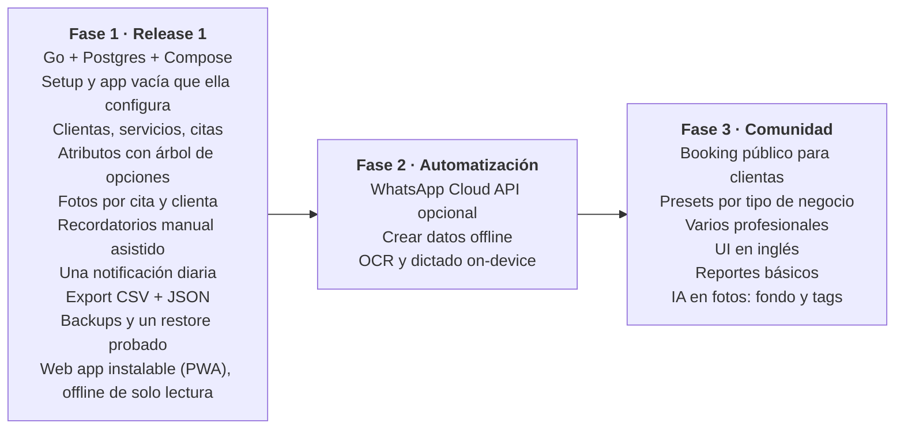

# PRD — Sistema de citas para emprendimientos

Oct 23, 2026 · jnaranj09 · actualizado el 2026-11-06 para el release 1

Este documento guarda el "qué" y el "por qué". El "cómo" vive en un solo lugar, [docs/designs/release-1.md](designs/release-1.md); si algo aquí no coincide con ese documento, manda el documento de diseño y este se corrige. El índice de decisiones de arquitectura (ADRs) está en [docs/sad.md](sad.md).

## Resumen y problema

Un sistema open source y self-hosted de clientas y citas para emprendimientos de servicios, empezando por un estudio de uñas que ya está abierto. Es un solo binario en Go con PostgreSQL que sirve un web client instalable como PWA en el iPhone. Se levanta con Docker Compose; la instalación de referencia corre en una PC de la casa detrás de un Cloudflare Tunnel.

Hoy una emprendedora de uñas lleva clientas, citas y recordatorios entre WhatsApp, una libreta y su memoria. Las herramientas existentes no le sirven:

- **SaaS** (AgendaPro, Fresha, Booksy): resuelven la agenda, pero los custom fields son limitados y casi nunca se pueden usar dentro de los mensajes, así que no se puede escribir "Aquí te esperamos con tu {bebida favorita}". Los datos viven en la plataforma de otro, con costo mensual y SMS cobrados aparte.
- **Opciones gratuitas self-hosted** (Easy!Appointments, Cal.com, Odoo Appointments): existen, pero están hechas alrededor de una página de booking público, pesan para correr en casa, y no ponen bien los campos propios dentro de los mensajes.
- **CRMs generales** (Twenty, EspoCRM): no están hechos para citas ni para usarse con una mano en el iPhone.

El hueco real es la combinación: sus propios atributos, usados dentro de sus propios mensajes, y configurados por ella desde el teléfono, sin código.

## Objetivos y no-objetivos

**Objetivos del release 1** (cada uno con su prueba; el detalle está en los Goals del documento de diseño)

1. **Ella configura sola la app vacía.** Prueba: en su propio iPhone y sin ayuda, crea sus servicios, al menos 5 atributos y una plantilla de recordatorio en menos de 20 minutos.
2. **Registrar una cita es rápido.** Prueba: una cita completa (clienta existente, servicio(s), fecha y atributos) en menos de 30 segundos desde el iPhone.
3. **Los recordatorios son correctos.** Pruebas: los tests de la lista de recordatorios (`internal/reminders`) tienen un caso que pasa por cada fila y cada regla de la tabla de reglas; y durante las 4 semanas de uso diario (objetivo 4) cada recordatorio que ella esperaba y no vio se anota como bug, sin ninguno abierto al final. Un recordatorio perdido porque la PC estaba apagada no es un bug.
4. **Ella la usa cada día de trabajo.** Prueba: 4 semanas de uso diario sin volver a la libreta. Los días con la PC apagada no cuentan como fallo ni reinician las 4 semanas.
5. **"Hoy" abre rápido.** Prueba: la pantalla "Hoy" abre en menos de 1 segundo en su iPhone, por LTE y a través del túnel. Con el servidor apagado, abre desde la cache del teléfono y lo dice en pantalla.
6. **Nada propio del negocio está en el código.** El modelo de atributos es lo bastante genérico para otros negocios (barbería, estética, tatuajes) sin cambiar código: zona horaria, moneda, código de país, nombre, marca, servicios, atributos y plantillas se configuran en la app. La app viene vacía, sin contenido de ejemplo.

Que una persona técnica la levante en su servidor en menos de 10 minutos ya no es objetivo del release 1: pasa al gate de la Fase 3 (ver "Alcance y fases").

**Prioridades** cuando dos objetivos chocan, en este orden:

1. Su uso diario y que pueda configurarla ella sola.
2. La seguridad de sus datos.
3. Que los recordatorios sean correctos.
4. Que una sola persona la pueda mantener.
5. Que sea genérica y que otros la puedan hospedar.

**No-objetivos (por ahora)**

- No es un SaaS: no hay hosting vendido, billing ni multi-tenancy comercial.
- No incluye booking público donde la clienta agenda sola (Fase 3).
- No procesa pagos. Guarda el monto pagado de la cita; no hay un campo de método de pago: si lo quiere, ella crea un atributo de opción para eso (por ejemplo SINPE Móvil o efectivo).
- No incluye inventario, nómina ni contabilidad.
- No hay apps nativas (iOS ni Android): la PWA cubre ambos.
- No envía por la WhatsApp Cloud API: el release 1 es manual asistido (Fase 2).
- No se crean ni editan datos con el servidor apagado: offline es solo lectura.
- No hay IA on-device ni borrado definitivo (ver la tabla del release 1).

## Usuarios y personas

| Persona | Quién es | Qué necesita | Canal principal |
| --- | --- | --- | --- |
| Emprendedora (owner) | Dueña del negocio de uñas, atiende ella misma | Agendar rápido entre clientas, ver el día de un vistazo, recordar detalles de cada clienta | PWA en el iPhone |
| Clienta final | Persona que recibe el servicio | Recordatorios claros y personales por WhatsApp; no usa la app | WhatsApp |
| Self-hoster | Persona técnica que instala el sistema para un negocio; en la instalación de referencia es el autor, que también actualiza, restaura y resetea contraseñas | Instalación simple, config por variables de entorno, backups, upgrades sin dolor | Docker Compose |
| Contributor | Dev de la comunidad open source | Código legible, contrato OpenAPI, tests, docs | GitHub |

La emprendedora es la usuaria principal: cada decisión de UX se mide contra "¿lo puede hacer con una mano, con la otra sosteniendo un pincel?"

## Requerimientos funcionales

Seis grupos: arranque y ajustes, clientas, atributos, servicios, citas y recordatorios. Los atributos son la pieza que conecta a los demás. La columna "Release 1" de la tabla de abajo dice qué entra.

### Arranque y ajustes (onboarding)

- **FR-O1** Link de setup de un solo uso: al arrancar sin usuaria, el servidor imprime el link en los logs; vale 24 h y deja de servir al terminar el setup. El comando `setup-link` crea uno nuevo.
- **FR-O2** Asistente de setup en el teléfono: nombre del negocio, zona horaria (empieza con la zona del navegador), moneda, código de país, color de acento, y luego su usuario y contraseña. Termina con los pasos para instalar la app en la pantalla de inicio.
- **FR-O3** Marca: nombre, color e ícono propios del negocio en la app instalada y en el manifest. El ícono se sube en el asistente, antes de instalar, porque iOS solo copia nombre e ícono al instalar.
- **FR-O4** Reset por línea de comandos: si olvida la contraseña, el autor corre `reset-password`; ella entra con la contraseña temporal y debe poner una nueva.
- **FR-O5** La app viene vacía, sin contenido de ejemplo. Cada pantalla que necesita algo que todavía no existe muestra un estado vacío que la lleva a crearlo: el primer servicio, la primera plantilla y la primera regla.

### Clientes

- **FR-C1** Crear, editar, buscar y archivar clientas (nombre, teléfono WhatsApp, notas).
- **FR-C2** Búsqueda instantánea por nombre o teléfono mientras se escribe.
- **FR-C3** Ficha de la clienta con sus atributos, historial de citas y galería de fotos.
- **FR-C4** Archivar en vez de borrar. El borrado definitivo queda diferido: si alguien lo pide, el autor lo hace con SQL.

### Atributos (custom fields)

- **FR-A1** La owner define atributos sin código, con scope `client` o `appointment`.
- **FR-A2** Cinco tipos: texto libre, número, fecha, opción única y opción múltiple. El método de pago es una opción que ella crea; el tipo imagen queda diferido.
- **FR-A3** Las opciones forman un árbol de cualquier profundidad (ejemplo: Forma → Almendra → Corta). El valor guarda solo el ID de la opción elegida; el camino se lee del árbol.
- **FR-A4** Atributos requeridos u opcionales, con orden configurable en el formulario.
- **FR-A5** Cada atributo tiene una `key` estable (ejemplo: `bebida_favorita`), generada de la etiqueta y oculta para ella, para usarla en templates.
- **FR-A6** (Diferido) Un atributo puede limitarse a ciertos servicios (ejemplo: "largo de uña" solo en acrílico).

### Servicios

- **FR-S1** Catálogo de servicios con nombre, duración, precio y color en el calendario.
- **FR-S2** Cada servicio puede tener sus reglas de vuelta (`come_back`, ver Recordatorios).
- **FR-S3** Una cita puede incluir varios servicios; la duración total se suma.

### Citas (appointments)

- **FR-P1** Crear cita: clienta + servicio(s) + fecha y hora + atributos de la cita.
- **FR-P2** Vista de día y de semana; detección de choques de horario.
- **FR-P3** Estados guardados: `scheduled`, `confirmed`, `cancelled`, `no_show`. "Realizada" no se guarda: se calcula en cada lectura (una cita `scheduled` o `confirmed` que ya terminó).
- **FR-P4** Adjuntar fotos a la cita (el diseño terminado, referencias de la clienta).
- **FR-P5** Reagendar y cancelar no tienen nada que recalcular: no se guardan recordatorios pendientes, y la lista se calcula de nuevo en cada lectura con los datos actuales.

### Recordatorios

- **FR-R1** Dos tipos de regla, en días enteros: "antes de la cita" (`before_appointment`), del negocio y para todas las citas (ejemplo: 1 día antes, o el mismo día); y "volver" (`come_back`), por servicio, N días después de una cita realizada (ejemplo: relleno a los 21 días), con un servicio de vuelta.
- **FR-R2** (Diferido) Recordatorios para la owner misma (ejemplo: "llamar a Ana para su relleno"). En el release 1 todo recordatorio es un mensaje a la clienta.
- **FR-R3** Templates con variables de la clienta, la cita y el negocio: `Aquí te esperamos con {{client.bebida_favorita}}`. Ella las inserta con chips y nunca ve la sintaxis.
- **FR-R4** Preview del mensaje ya renderizado antes de enviarlo.
- **FR-R5** Envío **manual asistido**: un tap abre WhatsApp con el mensaje y el número listos vía `wa.me`, y ella confirma que lo envió. El envío **automático** vía WhatsApp Cloud API queda para la Fase 2.
- **FR-R6** Bandeja "Para enviar hoy" con los recordatorios pendientes; marcar como enviado u omitido con un tap.
- **FR-R7** No mostrar el recordatorio de vuelta si la clienta tiene una cita posterior activa (ni cancelada ni "no vino") que incluye el servicio de vuelta de la regla (vacío = el servicio de la regla). Si tiene una cita futura sin ese servicio, la owner ve una sugerencia en vez del mensaje: "Ana tiene cita el 12/11 (Pedicure). ¿Agregar Relleno?" (Alternative E5 del documento de diseño).
- **FR-R8** Web Push a la owner (PWA instalada, iOS 16.4+): una sola notificación diaria con el resumen ("Tienes N mensajes para enviar hoy"), nunca después de las 20:00 hora del negocio.

### IA on-device (diferida)

Correría en el teléfono, sin servidor. Queda fuera del release 1 (ADR 017 en [docs/sad.md](sad.md)); cada una se vuelve a justificar contra lo que iOS ya hace (el dictado y la captura de texto ya vienen en iOS).

- **FR-I1** Escanear fotos de la libreta actual y proponer clientas y teléfonos para confirmar.
- **FR-I2** Leer un comprobante de SINPE Móvil y llenar el método de pago y el monto de la cita.
- **FR-I3** Dictar las notas de la cita por voz en español.
- **FR-I4** Quitar el fondo de las fotos de diseños terminados para portfolio.
- **FR-I5** Etiquetar las fotos de la galería con descripciones en español para buscarlas.

## Requerimientos no funcionales

Cuando chocan, mandan las prioridades de arriba.

| ID | Área | Requerimiento | Meta |
| --- | --- | --- | --- |
| NFR-1 | Performance API | Reemplazado por NFR-2: no hay meta de latencia del servidor | — |
| NFR-2 | Performance UI | Abrir "Hoy" en la PWA del iPhone, por LTE y a través del túnel | < 1 s; con el servidor apagado, desde la cache |
| NFR-3 | Performance UI | Búsqueda de clientas mientras se escribe (en el teléfono, sobre la cache) | < 100 ms por tecla |
| NFR-4 | Self-hosting | Instalación desde cero con `docker compose up` | < 10 min, cero pasos manuales en DB (gate de la Fase 3) |
| NFR-5 | Self-hosting | Recursos mínimos para un negocio | 1 vCPU, 1 GB RAM (gate de la Fase 3) |
| NFR-6 | Datos | Backups automáticos de Postgres y fotos | Diario + copia a una carpeta que se elige al instalar (`BACKUP_TARGET`) |
| NFR-7 | Datos | Export de los datos del negocio | CSV + JSON desde la app, sin fotos |
| NFR-8 | Seguridad | HTTPS y sesión obligatoria para los datos | HTTPS a través del ingress elegido |
| NFR-9 | Open source | Licencia, docs de instalación y contrato OpenAPI público | Repo listo para contributors (gate de la Fase 3) |
| NFR-10 | i18n | UI en español primero, preparada para inglés | Strings externalizados |
| NFR-11 | Zona horaria | Timestamps en UTC, zona horaria del negocio configurable | Sin default: el asistente la fija, empezando por la zona del navegador |

NFR-4, NFR-5 y NFR-9 pasan al gate de la Fase 3 del producto (no a la fase de construcción P3 del documento de diseño).

## Alcance del release 1

Cada requerimiento, dentro (In) o fuera (Out) del release 1. El detalle de cada uno está en el documento de diseño.

| ID | Release 1 | Nota |
| --- | --- | --- |
| FR-O1 | In | |
| FR-O2 | In | |
| FR-O3 | In | |
| FR-O4 | In | |
| FR-O5 | In | |
| FR-C1 | In | |
| FR-C2 | In | Búsqueda solo en el teléfono, sobre la cache |
| FR-C3 | In | |
| FR-C4 | In | Solo archivar; el borrado definitivo es Out |
| FR-A1 | In | |
| FR-A2 | In | Cinco tipos |
| FR-A3 | In | Árbol de cualquier profundidad |
| FR-A4 | In | |
| FR-A5 | In | |
| FR-A6 | Out | Diferido |
| FR-S1 | In | |
| FR-S2 | In | Solo reglas de vuelta; las reglas "antes" son del negocio |
| FR-S3 | In | |
| FR-P1 | In | |
| FR-P2 | In | |
| FR-P3 | In | "Realizada" se calcula, no se guarda |
| FR-P4 | In | |
| FR-P5 | In | No hay nada guardado que recalcular |
| FR-R1 | In | Dos tipos de regla |
| FR-R2 | Out | Diferido |
| FR-R3 | In | |
| FR-R4 | In | |
| FR-R5 | In | Solo manual asistido; el envío automático es Out (Fase 2) |
| FR-R6 | In | |
| FR-R7 | In | Con la sugerencia de agregar el servicio de vuelta |
| FR-R8 | In | Una notificación diaria |
| FR-I1 | Out | Diferido |
| FR-I2 | Out | Diferido |
| FR-I3 | Out | Diferido |
| FR-I4 | Out | Diferido |
| FR-I5 | Out | Diferido |
| NFR-1 | Out | Reemplazado por NFR-2 |
| NFR-2 | In | |
| NFR-3 | In | |
| NFR-4 | Out | Gate de la Fase 3 |
| NFR-5 | Out | Gate de la Fase 3 |
| NFR-6 | In | |
| NFR-7 | In | Sin fotos |
| NFR-8 | In | |
| NFR-9 | Out | Gate de la Fase 3 |
| NFR-10 | In | |
| NFR-11 | In | Sin zona horaria por defecto |

## Alcance y fases

El release 1 es la Fase 1: lo mínimo para que la emprendedora deje la libreta. Todo lo de la Fase 1 debe funcionar en su día a día antes de abrir el repo.

Gate a Fase 2: la owner usa el sistema a diario durante 4 semanas sin volver a la libreta. Gate a Fase 3: al menos una instalación externa levantada solo con la documentación, con NFR-4, NFR-5 y NFR-9 cumplidos.

## Métricas de éxito y preguntas abiertas

**Métricas**

| Métrica | Meta |
| --- | --- |
| Configurar la app vacía (servicios, 5 atributos, una plantilla), sola en su iPhone | < 20 min |
| Tiempo para registrar una cita completa | < 30 s |
| Recordatorios correctos | Un caso de test que pasa por cada regla de la lista de recordatorios; ningún bug de "recordatorio que no vi" abierto al final de las 4 semanas |
| Uso diario | 4 semanas sin volver a la libreta |
| Abrir "Hoy" en su iPhone, por LTE y a través del túnel | < 1 s |

**Preguntas abiertas**

- [ ] ¿Qué licencia open source: MIT o AGPL-3.0? Se decide antes de hacer público el repo.
- [ ] **Prueba en su iPhone**: ¿`wa.me` abierto desde la PWA instalada va directo a WhatsApp o pasa por Safari? ¿`whatsapp://send` funciona mejor? ¿Sobreviven tildes, emoji y saltos de línea? ¿Qué app abre si tiene WhatsApp y WhatsApp Business? Se responde con una página de prueba en su iPhone a través del túnel.

Las demás preguntas técnicas abiertas están en el documento de diseño ([Open Questions](designs/release-1.md#open-questions)).

**Preguntas cerradas**

- [x] ¿Qué atributos usa hoy ella con cada clienta? ¿Qué servicios ofrece y cada cuánto vuelve una clienta? Decisión de la owner, en lugar de la entrevista: la app viene vacía y ella define servicios, atributos, plantillas y reglas (FR-O5).
- [x] ¿Manual asistido por WhatsApp alcanza, o la API de Meta vale el costo y el trámite? Para el release 1, manual asistido; la Cloud API queda para la Fase 2.
- [x] ¿Nombre del proyecto? open-customer.

## Glosario

- **Relleno / come-back**: la visita de vuelta que algunos servicios necesitan después de N días. En uñas es el relleno. Una regla `come_back` le recuerda escribirle a la clienta, y nombra el servicio de vuelta que la clienta debería agendar.
- **SINPE Móvil**: transferencia bancaria por número de teléfono en Costa Rica, una forma común de pago de las clientas. La app no tiene campo de método de pago; ella puede crear un atributo de opción para eso.
- **Bandeja / "Para enviar hoy"**: la pantalla con los mensajes de recordatorio de hoy. Se abre desde la pestaña "Enviar" o desde el conteo en "Hoy".
- **Manual asistido**: la app prepara cada mensaje de WhatsApp y ella lo envía a mano por `wa.me`.
- **Owner**: la dueña del negocio, la única usuaria del release 1.
- **Template (mensaje) vs template (Meta)**: una plantilla de mensaje es el texto con variables que ella escribe en Ajustes → Plantillas. Un template de Meta es un mensaje que Meta debe aprobar antes de usarlo con la WhatsApp Cloud API (Fase 2); el release 1 no los usa.
